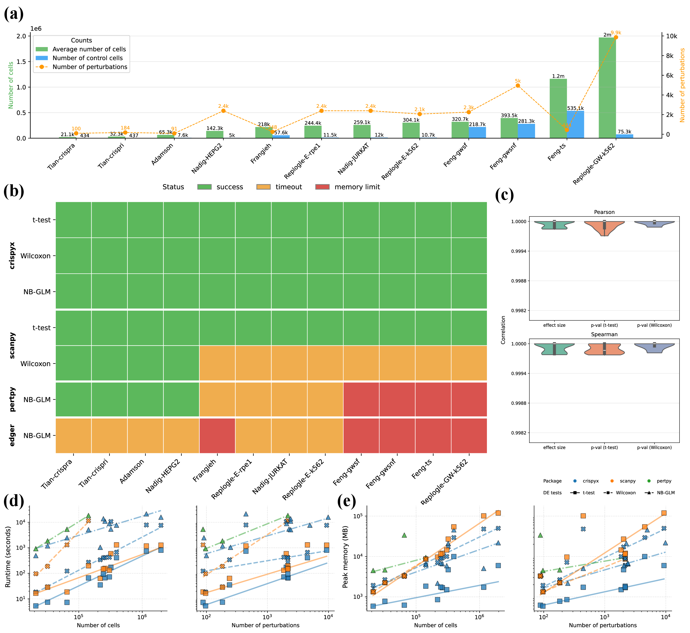

# crispyx

[](LICENSE)
[](https://www.python.org/downloads/)
[](https://pypi.org/project/crispyx)
[](https://pepy.tech/project/crispyx)
[](https://github.com/jinhongdu-lab/crispyx/actions/workflows/tests.yml)
[](https://crispyx.readthedocs.io/en/latest/)

## Motivation

Genome-wide CRISPR screens routinely produce datasets with hundreds of thousands of cells and tens of thousands of genes. Standard single-cell analysis toolkits (Scanpy, Pertpy) load the entire count matrix into memory, requiring large RAM allocations and often making routine workflows impractical on laptops or shared compute nodes.

**crispyx** runs quality control, normalisation, pseudo-bulk aggregation, differential expression (t-test, Wilcoxon, NB-GLM with covariates, covariate-adjusted residual effects), control checks and PCA/KNN on screens stored as `.h5ad` files, streaming from disk under a memory budget, so that million-cell screens run on a laptop or a cluster node. The API mirrors Scanpy. It starts from an `.h5ad` file; it does not read raw sequencing outputs, and it is not a general single-cell toolkit.

**Documentation:** [crispyx.readthedocs.io](https://crispyx.readthedocs.io/en/latest/) — [installation](https://crispyx.readthedocs.io/en/latest/installation.html), [quick start](https://crispyx.readthedocs.io/en/latest/quickstart.html), [tutorials](https://crispyx.readthedocs.io/en/latest/notebooks/crispyx_tutorial.html) and [API reference](https://crispyx.readthedocs.io/en/latest/api.html).

## Installation

```bash
pip install crispyx
```

For development (editable install with all extras):

```bash
git clone https://github.com/jinhongdu-lab/crispyx.git
cd crispyx
pip install -e ".[test,benchmark,docs]"
```

crispyx supports Python 3.10–3.12 and is compatible with recent releases of the
scientific stack, including `anndata >= 0.13` and `pandas >= 3.0` (where string
metadata is stored on disk using the nullable-string encoding).

## Quick start

```python
import crispyx as cx

# Open dataset without loading into memory
adata = cx.read_h5ad_ondisk("data/demo_benchmark.h5ad")

# Quality control with adaptive thresholds
adata = cx.pp.qc_summary(
    adata,
    perturbation_column="perturbation",
    min_genes=5,
    min_cells_per_perturbation=5,
)

# Differential expression
adata = cx.tl.rank_genes_groups(
    adata,
    perturbation_column="perturbation",
    method="wilcoxon",  # or "t-test", "nb_glm"
)

# Access results
print(adata.uns["rank_genes_groups"])
de_results = adata.uns["rank_genes_groups"].load()
```

For the full workflow (normalisation, PCA, pseudo-bulk, NB-GLM, LFC shrinkage, plotting, data preparation utilities), see the [Quick start](https://crispyx.readthedocs.io/en/latest/quickstart.html), which links each step's guide page, and the [tutorial](https://crispyx.readthedocs.io/en/latest/notebooks/crispyx_tutorial.html). [Covariate adjustment](https://crispyx.readthedocs.io/en/latest/covariate_adjustment.html) compares the ways to adjust for batches, donors and lines.

## Features

- **Streaming QC & preprocessing** – Filter cells, perturbations, and genes; normalise and log-transform; select highly variable genes (`seurat_v3`/`mean_dispersion`, control-cells-only by default); CSC-aware streaming with `format_mismatch_policy`; all without loading the full matrix into memory
- **Subsampling & downsampling** – Stratified or cluster-sampled cell subsampling (`cx.pp.subsample`, exact count or proportion per stratum, drop or keep small groups) and dependency-free per-cell count thinning (`cx.pp.downsample_counts`, the streaming equivalent of `scanpy.pp.downsample_counts`) for aligning dataset scale and sequencing depth before comparing screens
- **Pseudo-bulk aggregation** – Absolute profiles over multiple grouping columns (for example, perturbation × batch), strict count sums or mean log1p expression, optional deterministic bootstrap sampling, and explicit within-batch effect calculation
- **Differential expression** – t-test, Wilcoxon rank-sum (including batch-stratified / van Elteren test via `batch_column`), negative binomial GLM with covariates and apeGLM LFC shrinkage, and a fixed-offset NB test for many small perturbations against a large, stratified control set (`cx.tl.nb_offset_test`); multi-core support and adaptive memory management; per-condition low-expression filtering to exclude genes that are near-zero in both groups
- **Covariate-adjusted effects** – `cx.tl.residual_effects` (Feng et al., 2026) fits each gene to covariates such as donor, lane or batch on the control cells only, and takes a perturbation's effect as the mean residual of its cells. Unlike the NB GLM, which fits the covariates on counts jointly with each perturbation, the control fit is shared by every perturbation, so a perturbation's own cells cannot shift its covariate adjustment, and all perturbations come from one streaming pass. On a 1.16-million-cell screen it reproduces the published effects and significance calls in under a minute.
- **Storage-format aware** – Gene-streaming functions (`wilcoxon_test`, `batch_process`) can convert a CSR source once to a temporary, memory-bounded CSC copy beside the output instead of re-reading the whole matrix once per gene chunk; `format_mismatch_policy="auto"` (the default) measures the source's read throughput and does so only when the re-reads would really cost more than the conversion, so a small local file is streamed as-is and a large one on a network filesystem is converted; `convert_to_csc`/`convert_to_csr` honour `memory_limit_gb` and preserve the value dtype
- **Dimension reduction** – Memory-efficient PCA and KNN graph construction on backed data
- **Scanpy-compatible API & plotting** – Familiar `cx.pp`, `cx.pb`, `cx.tl`, and `cx.pl` namespaces; Scanpy-style rank genes plots, volcano, MA, PCA, UMAP, QC summaries, and overlap heatmaps
- **Data preparation utilities** – Edit backed metadata without loading X; normalise perturbation labels and take target genes out of guide names (`target_pattern`); assign guides from guide-capture counts (`cx.pp.assign_guides`); recover integer counts from data published as log1p-normalised values (`cx.pp.recover_counts`); sum the rows of a gene split over several (`cx.pp.collapse_genes`); concatenate multi-file screens; check a file for the mistakes that mislead an analysis (`cx.pp.check_data`); auto-detect metadata columns
- **HPC-ready** – Resume/checkpoint for long-running jobs; configurable `memory_limit_gb`
- **Disk-aware** – Estimates and warns about scratch-disk usage before large writes or CSC/CSR conversions, and `cx.estimate_disk_usage(...)` answers "how much disk will this need?" up front; the memory savings above assume the machine has enough free disk for streaming intermediates and output files

## Performance

Across 12 public CRISPR screens, crispyx completes every dataset where Scanpy, Pertpy/PyDESeq2 and edgeR run out of memory or time, with t-test and Wilcoxon results matching Scanpy to Pearson *r* > 0.999 and NB-GLM statistics agreeing with PyDESeq2 given the same size factors (z correlation 0.997–0.9999):

<p align="center">
  
</p>

## Running on HPC

crispyx reads its data from disk instead of loading it into memory, so where the files live matters as
much as cores or memory. Clusters usually offer several kinds of storage:

- **A parallel filesystem** (Lustre, GPFS, BeeGFS): large and fast for big sequential reads, but slow for
  small random reads.
- **Node-local disk** (`$TMPDIR` or `/tmp` on the compute node): fast for random access, but visible to
  one node only and usually wiped when the job ends.
- **Home and project directories:** often small and not meant for heavy I/O.

Steps that stream a file chunk by chunk, such as QC, normalisation, `residual_effects` and pseudo-bulk,
run well on a parallel filesystem. Steps that read or write cells and genes in scattered order do not:
sorting cells (`sort_by_perturbation`), converting between CSR and CSC, `nb_glm_test` on a file that is
not sorted by perturbation, and streaming a matrix along the axis it is not stored by. For those, copy
the input to node-local disk, write outputs and temporary files there too (`output_path`, `TMPDIR`),
and copy the results back before the job ends:

```bash
cp /parallel-fs/project/screen.h5ad "$TMPDIR"/
python analysis.py --input "$TMPDIR/screen.h5ad" --output "$TMPDIR/results"
cp -r "$TMPDIR/results" /parallel-fs/project/
```

## Acknowledgements

crispyx builds on the foundational work of [Scanpy](https://scanpy.readthedocs.io/) (Wolf *et al.*, 2018), [Pertpy](https://pertpy.readthedocs.io/), [PyDESeq2](https://pydeseq2.readthedocs.io/) (Muzellec *et al.*, 2023), and [AnnData](https://anndata.readthedocs.io/) (Virshup *et al.*, 2024). We gratefully acknowledge these projects for establishing the single-cell analysis ecosystem in Python; crispyx extends their APIs and algorithmic designs to enable memory-efficient, streaming computation for large-scale CRISPR screen datasets. `residual_effects` implements the covariate-adjusted effect estimator of Feng *et al.* (2026, [doi:10.1016/j.xgen.2025.101076](https://doi.org/10.1016/j.xgen.2025.101076)).

## Contributing

Suggestions, bug reports, and contributions are welcome! Please open an [issue](https://github.com/jaydu1/crispyx/issues) or submit a pull request.

## License

crispyx is released under a [Modified MIT License](LICENSE).
If you use crispyx in research, please cite it — see [CITATION.cff](CITATION.cff).
