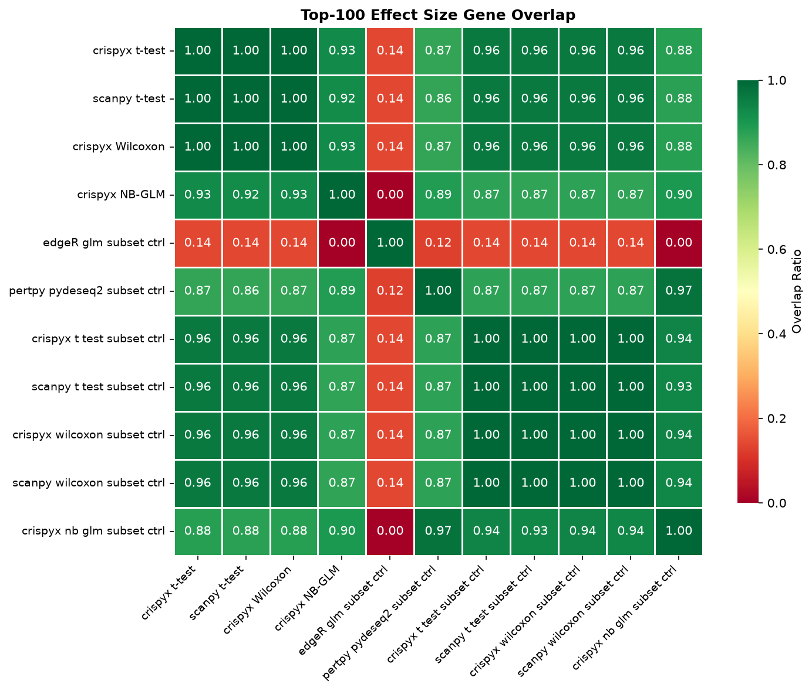
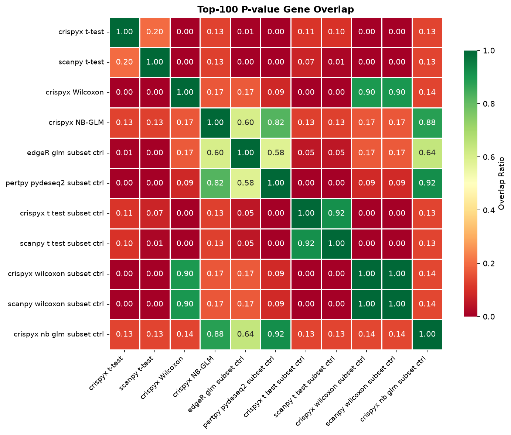

# Benchmark Results

## 1. Performance

### Preprocessing / QC

| Package | Method | Status | Total (s) | Memory (MB) | Cells | Genes |
| --- | --- | --- | --- | --- | --- | --- |
| crispyx | QC filter | success | 223.1 | 1429.18 | 320706.0 | 31772.0 |
| scanpy | QC filter | recovered | 163.34 | 90329.16 |  |  |
| crispyx | pseudobulk (avg log) | success | 231.67 | 7351.47 |  |  |
| crispyx | pseudobulk | success | 107.95 | 4768.52 |  |  |

### DE: t-test

| Package | Method | Status | Total (s) | Memory (MB) | Groups |
| --- | --- | --- | --- | --- | --- |
| scanpy | t-test | success | 590.32 | 26949.32 | 2031 |
| crispyx | t-test | success | 98.39 | 2389.54 | 2031 |

### DE: Wilcoxon

| Package | Method | Status | Total (s) | Memory (MB) | Groups |
| --- | --- | --- | --- | --- | --- |
| crispyx | Wilcoxon | success | 368.11 | 18136.91 | 2031.0 |
| scanpy | Wilcoxon | timeout | 32405.1 |  |  |

### DE: NB GLM

| Package | Method | Status | Total (s) | Memory (MB) | Groups |
| --- | --- | --- | --- | --- | --- |
| crispyx | NB-GLM | success | 1219.27 | 751.43 | 2031.0 |
| edgeR | NB-GLM | error | 22.42 |  |  |
| pertpy | NB-GLM | memory_limit | 276.74 | 124415.38 |  |

### Other

| Package | Method | Status | Total (s) | Memory (MB) | Groups |
| --- | --- | --- | --- | --- | --- |
| crispyx | preprocess | success | 133.38 | 975.68 |  |
| crispyx | standardize csr | success | 1.25 | 295.71 |  |

## 2. Performance Comparison

### crispyx vs Reference Tools

_crispyx as baseline. Negative values = crispyx is faster/uses less memory._

#### Preprocessing / QC

| crispyx method | compared to | Time Δ | Time % |  | Mem Δ | Mem % |   |
| --- | --- | --- | --- | --- | --- | --- | --- |
| QC filter | scanpy QC filter | +59.8s | 136.6% | ❌ | -88900.0 MB | 1.6% | ✅ |

#### DE: t-test

| crispyx method | compared to | Time Δ | Time % |  | Mem Δ | Mem % |   |
| --- | --- | --- | --- | --- | --- | --- | --- |
| t-test | scanpy t-test | -491.9s | 16.7% | ✅ | -24559.8 MB | 8.9% | ✅ |
| t-test (subset, capped control) | scanpy t-test (subset, capped control) | -28.4s | 24.9% | ✅ | -48.4 MB | 98.4% | ⚠️ |

#### DE: Wilcoxon

| crispyx method | compared to | Time Δ | Time % |  | Mem Δ | Mem % |   |
| --- | --- | --- | --- | --- | --- | --- | --- |
| Wilcoxon (subset, capped control) | scanpy Wilcoxon (subset, capped control) | -5214.4s | 0.7% | ✅ | -115.4 MB | 96.1% | ⚠️ |

#### DE: NB GLM

| crispyx method | compared to | Time Δ | Time % |  | Mem Δ | Mem % |   |
| --- | --- | --- | --- | --- | --- | --- | --- |
| NB-GLM (subset, capped control) | edgeR NB-GLM (subset, capped control) | -38827.6s | 0.4% | ✅ | +658.7 MB | 239.5% | ❌ |
| NB-GLM (subset, capped control) | pertpy NB-GLM (subset, capped control) | -11079.0s | 1.4% | ✅ | -139690.1 MB | 0.8% | ✅ |

### Tool Comparisons

_Comparisons between external tools._

| package A | method A | package B | method B | Time Δ (A-B) | Time % (A/B) |  | Mem Δ (A-B) | Mem % (A/B) |   |
| --- | --- | --- | --- | --- | --- | --- | --- | --- | --- |
| edgeR | NB-GLM (subset, capped control) | pertpy | NB-GLM (subset, capped control) | +27748.7s | 347.0% | ❌ | -140348.8 MB | 0.3% | ✅ |

## 3. Accuracy

_Correlation metrics between crispyx and reference methods. ✅ >0.95, ⚠️ 0.8-0.95, ❌ <0.8_

### Preprocessing / QC

| crispyx method | compared to | Cells Δ |  | Genes Δ |   |
| --- | --- | --- | --- | --- | --- |
| QC filter | scanpy QC filter | - | ❌ | - | ❌ |

### DE: t-test

| crispyx method | compared to | Eff ρ |  | Eff ρₛ |   | Stat ρ |    | Stat ρₛ |     | log-Pval ρ |      | log-Pval ρₛ |       |
| --- | --- | --- | --- | --- | --- | --- | --- | --- | --- | --- | --- | --- | --- |
| t-test | scanpy t-test | 1.000 <small>±0.000</small> | ✅ | 1.000 <small>±0.000</small> | ✅ | 1.000 <small>±0.000</small> | ✅ | 1.000 <small>±0.000</small> | ✅ | 1.000 <small>±0.000</small> | ✅ | 1.000 <small>±0.000</small> | ✅ |
| t-test (subset, capped control) | scanpy t-test (subset, capped control) | 1.000 <small>±0.000</small> | ✅ | 1.000 <small>±0.000</small> | ✅ | 1.000 <small>±0.000</small> | ✅ | 1.000 <small>±0.000</small> | ✅ | 1.000 <small>±0.000</small> | ✅ | 1.000 <small>±0.000</small> | ✅ |

### DE: Wilcoxon

| crispyx method | compared to | Eff ρ |  | Eff ρₛ |   | Stat ρ |    | Stat ρₛ |     | log-Pval ρ |      | log-Pval ρₛ |       |
| --- | --- | --- | --- | --- | --- | --- | --- | --- | --- | --- | --- | --- | --- |
| Wilcoxon (subset, capped control) | scanpy Wilcoxon (subset, capped control) | 1.000 <small>±0.000</small> | ✅ | 1.000 <small>±0.000</small> | ✅ | 1.000 <small>±0.000</small> | ✅ | 1.000 <small>±0.000</small> | ✅ | 1.000 <small>±0.000</small> | ✅ | 1.000 <small>±0.000</small> | ✅ |

### DE: NB GLM

| crispyx method | compared to | Eff ρ |  | Eff ρₛ |   | Stat ρ |    | Stat ρₛ |     | log-Pval ρ |      | log-Pval ρₛ |       |
| --- | --- | --- | --- | --- | --- | --- | --- | --- | --- | --- | --- | --- | --- |
| NB-GLM (subset, capped control) | edgeR NB-GLM (subset, capped control) | 0.657 <small>±0.077</small> | ❌ | 0.946 <small>±0.023</small> | ⚠️ | 0.182 <small>±0.032</small> | ❌ | 0.216 <small>±0.059</small> | ❌ | 0.938 <small>±0.039</small> | ⚠️ | 0.991 <small>±0.001</small> | ✅ |
| NB-GLM (subset, capped control) | pertpy NB-GLM (subset, capped control) | 0.995 <small>±0.007</small> | ✅ | 0.999 <small>±0.001</small> | ✅ | 0.998 <small>±0.001</small> | ✅ | 0.999 <small>±0.000</small> | ✅ | 0.994 <small>±0.002</small> | ✅ | 0.999 <small>±0.000</small> | ✅ |

### Tool Comparisons

| package A | method A | package B | method B | Eff ρ |  | Eff ρₛ |   | Stat ρ |    | Stat ρₛ |     | log-Pval ρ |      | log-Pval ρₛ |       |
| --- | --- | --- | --- | --- | --- | --- | --- | --- | --- | --- | --- | --- | --- | --- | --- |
| edgeR | NB-GLM (subset, capped control) | pertpy | NB-GLM (subset, capped control) | 0.257 <small>±0.055</small> | ❌ | 0.597 <small>±0.026</small> | ❌ | 0.145 <small>±0.025</small> | ❌ | -0.082 <small>±0.041</small> | ❌ | 0.857 <small>±0.039</small> | ⚠️ | 0.840 <small>±0.018</small> | ⚠️ |

## 4. Gene Set Overlap

_Overlap ratio of top-k DE genes between methods. ✅ >0.7, ⚠️ 0.5-0.7, ❌ <0.5_

### Effect Size Overlap

| crispyx method | compared to | Top-50 |  | Top-100 |   | Top-500 |    |
| --- | --- | --- | --- | --- | --- | --- | --- |
| t-test | scanpy t-test | 1.000 | ✅ | 1.000 | ✅ | 1.000 | ✅ |
| t-test (subset, capped control) | scanpy t-test (subset, capped control) | 1.000 | ✅ | 1.000 | ✅ | 1.000 | ✅ |
| Wilcoxon (subset, capped control) | scanpy Wilcoxon (subset, capped control) | 1.000 | ✅ | 1.000 | ✅ | 1.000 | ✅ |
| NB-GLM (subset, capped control) | edgeR NB-GLM (subset, capped control) | 0.002 | ❌ | 0.003 | ❌ | 0.074 | ❌ |
| NB-GLM (subset, capped control) | pertpy NB-GLM (subset, capped control) | 0.971 | ✅ | 0.973 | ✅ | 0.989 | ✅ |

### P-value Overlap

| crispyx method | compared to | Top-50 |  | Top-100 |   | Top-500 |    |
| --- | --- | --- | --- | --- | --- | --- | --- |
| t-test | scanpy t-test | 1.000 | ✅ | 1.000 | ✅ | 1.000 | ✅ |
| t-test (subset, capped control) | scanpy t-test (subset, capped control) | 1.000 | ✅ | 1.000 | ✅ | 1.000 | ✅ |
| Wilcoxon (subset, capped control) | scanpy Wilcoxon (subset, capped control) | 1.000 | ✅ | 1.000 | ✅ | 1.000 | ✅ |
| NB-GLM (subset, capped control) | edgeR NB-GLM (subset, capped control) | 0.594 | ⚠️ | 0.641 | ⚠️ | 0.719 | ✅ |
| NB-GLM (subset, capped control) | pertpy NB-GLM (subset, capped control) | 0.915 | ✅ | 0.920 | ✅ | 0.936 | ✅ |

_Note: Some methods are missing due to errors:_
- Wilcoxon vs scanpy Wilcoxon: _missing output: scanpy_de_wilcoxon (no output file)_
- t-test vs scanpy t-test (subset): _missing output: scanpy_de_t_test_subset (not run, no output)_
- Wilcoxon vs scanpy Wilcoxon (subset): _missing output: scanpy_de_wilcoxon_subset (not run, no output)_
- NB-GLM vs pertpy NB-GLM (subset): _missing output: pertpy_de_pydeseq2_subset (not run, no output)_
- NB-GLM vs edgeR NB-GLM (subset): _missing output: edger_de_glm_subset (no output file)_

### Overlap Heatmaps (Top-100)

#### Effect Size

#### P-value

---

**Legend:**
- **Performance:** ✅ >10% better | ⚠️ within ±10% | ❌ >10% worse
- **Accuracy:** ✅ ρ≥0.95 | ⚠️ 0.8≤ρ<0.95 | ❌ ρ<0.8
- **Overlap:** ✅ ≥0.7 | ⚠️ 0.5-0.7 | ❌ <0.5
- **Shrinkage:** ✅ <1% inflated | ⚠️ 1-10% inflated | ❌ >10% inflated

**Abbreviations:**
- ρ = Pearson correlation, ρₛ = Spearman correlation
- log-Pval = correlations on -log₁₀(p) transformed values
- sf=per = per-comparison size factor estimation (matches PyDESeq2)

**Notes:**
- Correlation and overlap values shown as mean±std across perturbations
- crispyx lfcShrink uses `method='stats'` (Gaussian approximation) which is numerically stable and ~35× faster than `method='full'`.
- P-value overlap excludes lfcShrink methods since shrinkage only affects effect sizes, not p-values.
- **Warning:** PyDESeq2 may produce aberrant shrinkage when dispersion trend fitting fails. crispyx shrinkage is more robust.

## Accuracy subset

Accuracy metrics use the same 50 seeded perturbations (seed 0) for every method; the list is in `.accuracy_perturbations.json`.

Reruns on that subset, for accuracy only: they are not performance rows, and their time and memory (kept in `benchmark_accuracy_reruns.csv` for the record) are not compared. Performance uses the full-data runs, where a failure (timeout, memory limit) is the result. `_subset` = full control; `_subset_ctrl` = control capped, crispyx rerun on the same cells.

Control: 218,652 cells, cap 20,000. By the rule (decided by the control's size, not by which runs fit on a machine), this dataset's primary accuracy comparisons use the **capped** control (`_subset_ctrl` pairs, every method on the same cells); comparisons on the full control are supplementary.

| method | status | perturbations | control cells |
| --- | --- | --- | --- |
| crispyx_de_nb_glm_subset_ctrl | success | 50.0 |  |
| crispyx_de_t_test_subset_ctrl | success | 50.0 |  |
| crispyx_de_wilcoxon_subset_ctrl | success | 50.0 |  |
| edger_de_glm_subset | error | nan |  |
| edger_de_glm_subset_ctrl | success | 50.0 | 20,000 |
| pertpy_de_pydeseq2_subset_ctrl | success | 50.0 | 20,000 |
| scanpy_de_t_test_subset_ctrl | success | 50.0 | 20,000 |
| scanpy_de_wilcoxon_subset_ctrl | success | 50.0 | 20,000 |
