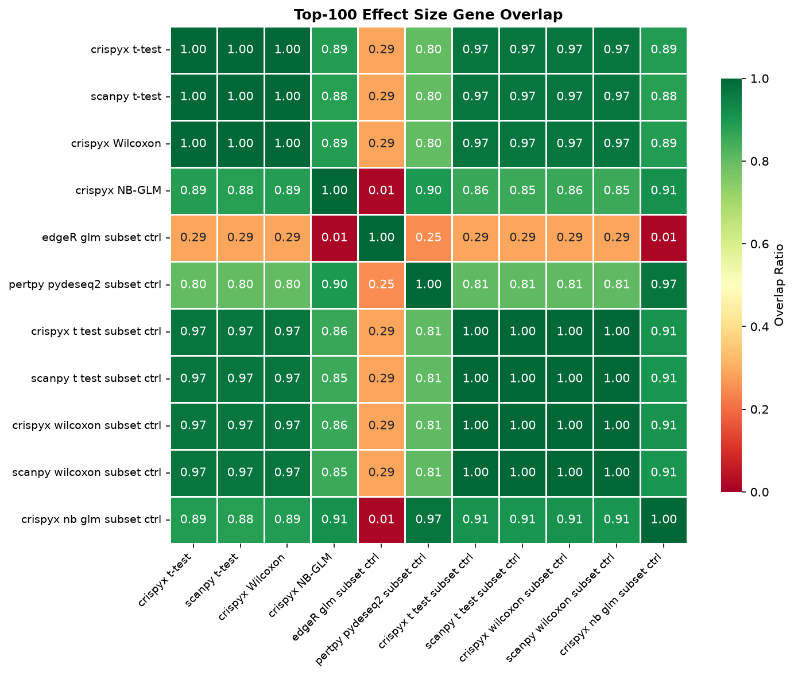
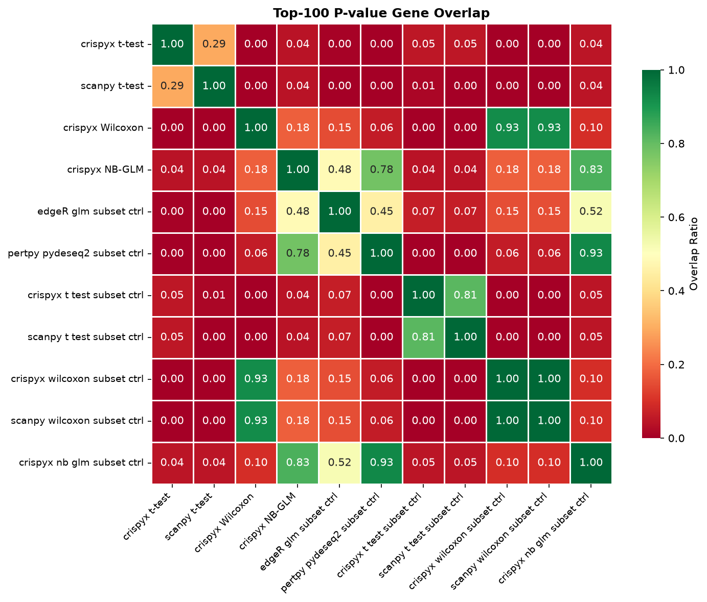

# Benchmark Results

## 1. Performance

### Preprocessing / QC

| Package | Method | Status | Total (s) | Memory (MB) | Cells | Genes |
| --- | --- | --- | --- | --- | --- | --- |
| crispyx | QC filter | success | 274.94 | 1596.04 | 393465.0 | 32373.0 |
| scanpy | QC filter | recovered | 422.96 | 110752.68 |  |  |
| crispyx | pseudobulk (avg log) | success | 301.55 | 12303.99 |  |  |
| crispyx | pseudobulk | success | 139.83 | 7253.75 |  |  |

### DE: t-test

| Package | Method | Status | Total (s) | Memory (MB) | Groups |
| --- | --- | --- | --- | --- | --- |
| scanpy | t-test | success | 1304.2 | 54165.91 | 4516 |
| crispyx | t-test | success | 183.58 | 4851.03 | 4516 |

### DE: Wilcoxon

| Package | Method | Status | Total (s) | Memory (MB) | Groups |
| --- | --- | --- | --- | --- | --- |
| crispyx | Wilcoxon | success | 495.92 | 20210.33 | 4516.0 |
| scanpy | Wilcoxon | timeout | 21605.1 |  |  |

### DE: NB GLM

| Package | Method | Status | Total (s) | Memory (MB) | Groups |
| --- | --- | --- | --- | --- | --- |
| crispyx | NB-GLM | success | 2636.32 | 881.55 | 4516.0 |
| edgeR | NB-GLM | error | 30.76 |  |  |
| pertpy | NB-GLM | memory_limit | 297.14 | 121987.74 |  |

### Other

| Package | Method | Status | Total (s) | Memory (MB) | Groups |
| --- | --- | --- | --- | --- | --- |
| crispyx | preprocess | success | 178.09 | 1115.2 |  |
| crispyx | standardize csr | success | 1.38 | 318.36 |  |

## 2. Performance Comparison

### crispyx vs Reference Tools

_crispyx as baseline. Negative values = crispyx is faster/uses less memory._

#### Preprocessing / QC

| crispyx method | compared to | Time Δ | Time % |  | Mem Δ | Mem % |   |
| --- | --- | --- | --- | --- | --- | --- | --- |
| QC filter | scanpy QC filter | -148.0s | 65.0% | ✅ | -109156.6 MB | 1.4% | ✅ |

#### DE: t-test

| crispyx method | compared to | Time Δ | Time % |  | Mem Δ | Mem % |   |
| --- | --- | --- | --- | --- | --- | --- | --- |
| t-test | scanpy t-test | -1120.6s | 14.1% | ✅ | -49314.9 MB | 9.0% | ✅ |
| t-test (subset, capped control) | scanpy t-test (subset, capped control) | -12.4s | 41.8% | ✅ | -47.4 MB | 98.2% | ⚠️ |

#### DE: Wilcoxon

| crispyx method | compared to | Time Δ | Time % |  | Mem Δ | Mem % |   |
| --- | --- | --- | --- | --- | --- | --- | --- |
| Wilcoxon (subset, capped control) | scanpy Wilcoxon (subset, capped control) | -5142.3s | 0.6% | ✅ | -173.3 MB | 93.7% | ⚠️ |

#### DE: NB GLM

| crispyx method | compared to | Time Δ | Time % |  | Mem Δ | Mem % |   |
| --- | --- | --- | --- | --- | --- | --- | --- |
| NB-GLM (subset, capped control) | edgeR NB-GLM (subset, capped control) | -38366.0s | 0.3% | ✅ | +539.6 MB | 191.1% | ❌ |
| NB-GLM (subset, capped control) | pertpy NB-GLM (subset, capped control) | -12342.3s | 0.9% | ✅ | -141585.1 MB | 0.8% | ✅ |

### Tool Comparisons

_Comparisons between external tools._

| package A | method A | package B | method B | Time Δ (A-B) | Time % (A/B) |  | Mem Δ (A-B) | Mem % (A/B) |   |
| --- | --- | --- | --- | --- | --- | --- | --- | --- | --- |
| edgeR | NB-GLM (subset, capped control) | pertpy | NB-GLM (subset, capped control) | +26023.7s | 309.0% | ❌ | -142124.8 MB | 0.4% | ✅ |

## 3. Accuracy

_Correlation metrics between crispyx and reference methods. ✅ >0.95, ⚠️ 0.8-0.95, ❌ <0.8_

### Preprocessing / QC

| crispyx method | compared to | Cells Δ |  | Genes Δ |   |
| --- | --- | --- | --- | --- | --- |
| QC filter | scanpy QC filter | - | ❌ | - | ❌ |

### DE: t-test

| crispyx method | compared to | Eff ρ |  | Eff ρₛ |   | Stat ρ |    | Stat ρₛ |     | log-Pval ρ |      | log-Pval ρₛ |       |
| --- | --- | --- | --- | --- | --- | --- | --- | --- | --- | --- | --- | --- | --- |
| t-test | scanpy t-test | 1.000 <small>±0.000</small> | ✅ | 1.000 <small>±0.000</small> | ✅ | 1.000 <small>±0.000</small> | ✅ | 1.000 <small>±0.000</small> | ✅ | 1.000 <small>±0.000</small> | ✅ | 1.000 <small>±0.000</small> | ✅ |
| t-test (subset, capped control) | scanpy t-test (subset, capped control) | 1.000 <small>±0.000</small> | ✅ | 1.000 <small>±0.000</small> | ✅ | 1.000 <small>±0.000</small> | ✅ | 1.000 <small>±0.000</small> | ✅ | 1.000 <small>±0.000</small> | ✅ | 1.000 <small>±0.000</small> | ✅ |

### DE: Wilcoxon

| crispyx method | compared to | Eff ρ |  | Eff ρₛ |   | Stat ρ |    | Stat ρₛ |     | log-Pval ρ |      | log-Pval ρₛ |       |
| --- | --- | --- | --- | --- | --- | --- | --- | --- | --- | --- | --- | --- | --- |
| Wilcoxon (subset, capped control) | scanpy Wilcoxon (subset, capped control) | 1.000 <small>±0.000</small> | ✅ | 1.000 <small>±0.000</small> | ✅ | 1.000 <small>±0.000</small> | ✅ | 1.000 <small>±0.000</small> | ✅ | 1.000 <small>±0.000</small> | ✅ | 1.000 <small>±0.000</small> | ✅ |

### DE: NB GLM

| crispyx method | compared to | Eff ρ |  | Eff ρₛ |   | Stat ρ |    | Stat ρₛ |     | log-Pval ρ |      | log-Pval ρₛ |       |
| --- | --- | --- | --- | --- | --- | --- | --- | --- | --- | --- | --- | --- | --- |
| NB-GLM (subset, capped control) | edgeR NB-GLM (subset, capped control) | 0.731 <small>±0.061</small> | ❌ | 0.960 <small>±0.017</small> | ✅ | 0.152 <small>±0.026</small> | ❌ | 0.240 <small>±0.080</small> | ❌ | 0.879 <small>±0.127</small> | ⚠️ | 0.982 <small>±0.004</small> | ✅ |
| NB-GLM (subset, capped control) | pertpy NB-GLM (subset, capped control) | 0.989 <small>±0.024</small> | ✅ | 0.998 <small>±0.001</small> | ✅ | 0.998 <small>±0.002</small> | ✅ | 0.999 <small>±0.001</small> | ✅ | 0.992 <small>±0.012</small> | ✅ | 0.998 <small>±0.001</small> | ✅ |

### Tool Comparisons

| package A | method A | package B | method B | Eff ρ |  | Eff ρₛ |   | Stat ρ |    | Stat ρₛ |     | log-Pval ρ |      | log-Pval ρₛ |       |
| --- | --- | --- | --- | --- | --- | --- | --- | --- | --- | --- | --- | --- | --- | --- | --- |
| edgeR | NB-GLM (subset, capped control) | pertpy | NB-GLM (subset, capped control) | 0.319 <small>±0.065</small> | ❌ | 0.607 <small>±0.035</small> | ❌ | 0.128 <small>±0.021</small> | ❌ | -0.122 <small>±0.037</small> | ❌ | 0.781 <small>±0.127</small> | ❌ | 0.839 <small>±0.018</small> | ⚠️ |

## 4. Gene Set Overlap

_Overlap ratio of top-k DE genes between methods. ✅ >0.7, ⚠️ 0.5-0.7, ❌ <0.5_

### Effect Size Overlap

| crispyx method | compared to | Top-50 |  | Top-100 |   | Top-500 |    |
| --- | --- | --- | --- | --- | --- | --- | --- |
| t-test | scanpy t-test | 1.000 | ✅ | 1.000 | ✅ | 1.000 | ✅ |
| t-test (subset, capped control) | scanpy t-test (subset, capped control) | 1.000 | ✅ | 1.000 | ✅ | 1.000 | ✅ |
| Wilcoxon (subset, capped control) | scanpy Wilcoxon (subset, capped control) | 1.000 | ✅ | 1.000 | ✅ | 1.000 | ✅ |
| NB-GLM (subset, capped control) | edgeR NB-GLM (subset, capped control) | 0.014 | ❌ | 0.015 | ❌ | 0.127 | ❌ |
| NB-GLM (subset, capped control) | pertpy NB-GLM (subset, capped control) | 0.966 | ✅ | 0.970 | ✅ | 0.988 | ✅ |

### P-value Overlap

| crispyx method | compared to | Top-50 |  | Top-100 |   | Top-500 |    |
| --- | --- | --- | --- | --- | --- | --- | --- |
| t-test | scanpy t-test | 1.000 | ✅ | 1.000 | ✅ | 1.000 | ✅ |
| t-test (subset, capped control) | scanpy t-test (subset, capped control) | 0.991 | ✅ | 1.000 | ✅ | 1.000 | ✅ |
| Wilcoxon (subset, capped control) | scanpy Wilcoxon (subset, capped control) | 1.000 | ✅ | 1.000 | ✅ | 1.000 | ✅ |
| NB-GLM (subset, capped control) | edgeR NB-GLM (subset, capped control) | 0.446 | ❌ | 0.523 | ⚠️ | 0.658 | ⚠️ |
| NB-GLM (subset, capped control) | pertpy NB-GLM (subset, capped control) | 0.914 | ✅ | 0.930 | ✅ | 0.933 | ✅ |

_Note: Some methods are missing due to errors:_
- Wilcoxon vs scanpy Wilcoxon: _missing output: scanpy_de_wilcoxon (no output file)_
- t-test vs scanpy t-test (subset): _missing output: scanpy_de_t_test_subset (not run, no output)_
- Wilcoxon vs scanpy Wilcoxon (subset): _missing output: scanpy_de_wilcoxon_subset (not run, no output)_
- NB-GLM vs pertpy NB-GLM (subset): _missing output: pertpy_de_pydeseq2_subset (not run, no output)_
- NB-GLM vs edgeR NB-GLM (subset): _missing output: edger_de_glm_subset (not run, no output)_

### Overlap Heatmaps (Top-100)

#### Effect Size

#### P-value

---

**Legend:**
- **Performance:** ✅ >10% better | ⚠️ within ±10% | ❌ >10% worse
- **Accuracy:** ✅ ρ≥0.95 | ⚠️ 0.8≤ρ<0.95 | ❌ ρ<0.8
- **Overlap:** ✅ ≥0.7 | ⚠️ 0.5-0.7 | ❌ <0.5
- **Shrinkage:** ✅ <1% inflated | ⚠️ 1-10% inflated | ❌ >10% inflated

**Abbreviations:**
- ρ = Pearson correlation, ρₛ = Spearman correlation
- log-Pval = correlations on -log₁₀(p) transformed values
- sf=per = per-comparison size factor estimation (matches PyDESeq2)

**Notes:**
- Correlation and overlap values shown as mean±std across perturbations
- crispyx lfcShrink uses `method='stats'` (Gaussian approximation) which is numerically stable and ~35× faster than `method='full'`.
- P-value overlap excludes lfcShrink methods since shrinkage only affects effect sizes, not p-values.
- **Warning:** PyDESeq2 may produce aberrant shrinkage when dispersion trend fitting fails. crispyx shrinkage is more robust.

## Accuracy subset

Accuracy metrics use the same 50 seeded perturbations (seed 0) for every method; the list is in `.accuracy_perturbations.json`.

Reruns on that subset, for accuracy only: they are not performance rows, and their time and memory (kept in `benchmark_accuracy_reruns.csv` for the record) are not compared. Performance uses the full-data runs, where a failure (timeout, memory limit) is the result. `_subset` = full control; `_subset_ctrl` = control capped, crispyx rerun on the same cells.

Control: 281,346 cells, cap 20,000. By the rule (decided by the control's size, not by which runs fit on a machine), this dataset's primary accuracy comparisons use the **capped** control (`_subset_ctrl` pairs, every method on the same cells); comparisons on the full control are supplementary.

| method | status | perturbations | control cells |
| --- | --- | --- | --- |
| crispyx_de_nb_glm_subset_ctrl | success | 50.0 |  |
| crispyx_de_t_test_subset_ctrl | success | 50.0 |  |
| crispyx_de_wilcoxon_subset_ctrl | success | 50.0 |  |
| edger_de_glm_subset_ctrl | success | 50.0 | 20,000 |
| pertpy_de_pydeseq2_subset_ctrl | success | 50.0 | 20,000 |
| scanpy_de_t_test_subset_ctrl | success | 50.0 | 20,000 |
| scanpy_de_wilcoxon_subset_ctrl | success | 50.0 | 20,000 |
