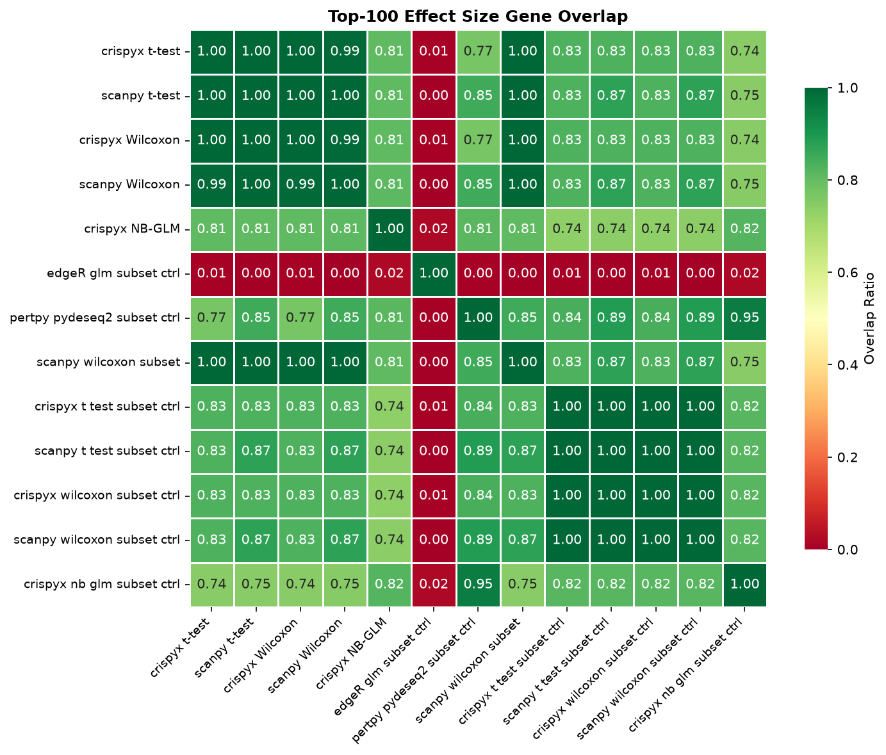
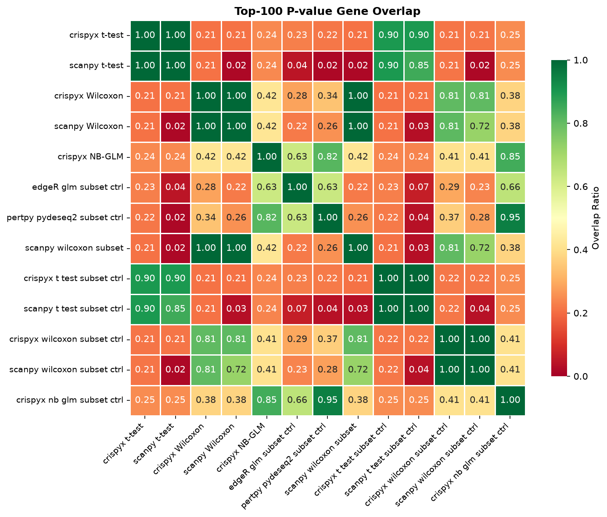

# Benchmark Results

## 1. Performance

### Preprocessing / QC

| Package | Method | Status | Total (s) | Memory (MB) | Cells | Genes |
| --- | --- | --- | --- | --- | --- | --- |
| crispyx | QC filter | success | 15.27 | 17361.77 | 218023.0 | 23710.0 |
| scanpy | QC filter | success | 101.89 | 23060.96 | 218023.0 | 23710.0 |
| crispyx | pseudobulk (avg log) | success | 87.11 | 3115.3 |  |  |
| crispyx | pseudobulk | success | 39.68 | 2285.12 |  |  |

### DE: t-test

| Package | Method | Status | Total (s) | Memory (MB) | Groups |
| --- | --- | --- | --- | --- | --- |
| scanpy | t-test | success | 63.72 | 9674.27 | 239 |
| crispyx | t-test | success | 26.02 | 828.79 | 239 |

### DE: Wilcoxon

| Package | Method | Status | Total (s) | Memory (MB) | Groups |
| --- | --- | --- | --- | --- | --- |
| crispyx | Wilcoxon | success | 104.24 | 10971.36 | 239.0 |
| scanpy | Wilcoxon | recovered | 21605.1 |  |  |

### DE: NB GLM

| Package | Method | Status | Total (s) | Memory (MB) | Groups |
| --- | --- | --- | --- | --- | --- |
| crispyx | NB-GLM | success | 424.44 | 1046.39 | 239.0 |
| edgeR | NB-GLM | error | 1380.13 |  |  |
| pertpy | NB-GLM | timeout | 21606.51 |  |  |

### Other

| Package | Method | Status | Total (s) | Memory (MB) | Groups |
| --- | --- | --- | --- | --- | --- |
| crispyx | preprocess | success | 62.6 | 746.0 |  |
| crispyx | standardize csr | success | 1.11 | 355.09 |  |

## 2. Performance Comparison

### crispyx vs Reference Tools

_crispyx as baseline. Negative values = crispyx is faster/uses less memory._

#### Preprocessing / QC

| crispyx method | compared to | Time Δ | Time % |  | Mem Δ | Mem % |   |
| --- | --- | --- | --- | --- | --- | --- | --- |
| QC filter | scanpy QC filter | -86.6s | 15.0% | ✅ | -5699.2 MB | 75.3% | ✅ |

#### DE: t-test

| crispyx method | compared to | Time Δ | Time % |  | Mem Δ | Mem % |   |
| --- | --- | --- | --- | --- | --- | --- | --- |
| t-test | scanpy t-test | -37.7s | 40.8% | ✅ | -8845.5 MB | 8.6% | ✅ |
| t-test (subset, capped control) | scanpy t-test (subset, capped control) | -18.5s | 42.1% | ✅ | -24.5 MB | 99.3% | ⚠️ |

#### DE: Wilcoxon

| crispyx method | compared to | Time Δ | Time % |  | Mem Δ | Mem % |   |
| --- | --- | --- | --- | --- | --- | --- | --- |
| Wilcoxon | scanpy Wilcoxon | -21500.9s | 0.5% | ✅ | - | - |  |
| Wilcoxon | scanpy Wilcoxon (subset) | -7120.6s | 1.4% | ✅ | +5173.7 MB | 189.2% | ❌ |
| Wilcoxon (subset, capped control) | scanpy Wilcoxon (subset, capped control) | -3398.9s | 2.4% | ✅ | -93.4 MB | 97.5% | ⚠️ |

#### DE: NB GLM

| crispyx method | compared to | Time Δ | Time % |  | Mem Δ | Mem % |   |
| --- | --- | --- | --- | --- | --- | --- | --- |
| NB-GLM (subset, capped control) | edgeR NB-GLM (subset, capped control) | -29482.2s | 1.2% | ✅ | +1021.4 MB | 378.3% | ❌ |
| NB-GLM (subset, capped control) | pertpy NB-GLM (subset, capped control) | -5925.2s | 5.8% | ✅ | -111560.2 MB | 1.2% | ✅ |

### Tool Comparisons

_Comparisons between external tools._

| package A | method A | package B | method B | Time Δ (A-B) | Time % (A/B) |  | Mem Δ (A-B) | Mem % (A/B) |   |
| --- | --- | --- | --- | --- | --- | --- | --- | --- | --- |
| edgeR | NB-GLM (subset, capped control) | pertpy | NB-GLM (subset, capped control) | +23557.0s | 474.6% | ❌ | -112581.6 MB | 0.3% | ✅ |

## 3. Accuracy

_Correlation metrics between crispyx and reference methods. ✅ >0.95, ⚠️ 0.8-0.95, ❌ <0.8_

### Preprocessing / QC

| crispyx method | compared to | Cells Δ |  | Genes Δ |   |
| --- | --- | --- | --- | --- | --- |
| QC filter | scanpy QC filter | +0 | ✅ | +0 | ✅ |

### DE: t-test

| crispyx method | compared to | Eff ρ |  | Eff ρₛ |   | Stat ρ |    | Stat ρₛ |     | log-Pval ρ |      | log-Pval ρₛ |       |
| --- | --- | --- | --- | --- | --- | --- | --- | --- | --- | --- | --- | --- | --- |
| t-test | scanpy t-test | 1.000 <small>±0.000</small> | ✅ | 1.000 <small>±0.000</small> | ✅ | 1.000 <small>±0.000</small> | ✅ | 1.000 <small>±0.000</small> | ✅ | 1.000 <small>±0.000</small> | ✅ | 1.000 <small>±0.000</small> | ✅ |
| t-test (subset, capped control) | scanpy t-test (subset, capped control) | 1.000 <small>±0.000</small> | ✅ | 1.000 <small>±0.000</small> | ✅ | 1.000 <small>±0.000</small> | ✅ | 1.000 <small>±0.000</small> | ✅ | 1.000 <small>±0.000</small> | ✅ | 1.000 <small>±0.000</small> | ✅ |

### DE: Wilcoxon

| crispyx method | compared to | Eff ρ |  | Eff ρₛ |   | Stat ρ |    | Stat ρₛ |     | log-Pval ρ |      | log-Pval ρₛ |       |
| --- | --- | --- | --- | --- | --- | --- | --- | --- | --- | --- | --- | --- | --- |
| Wilcoxon | scanpy Wilcoxon | 1.000 <small>±0.000</small> | ✅ | 1.000 <small>±0.000</small> | ✅ | 1.000 <small>±0.000</small> | ✅ | 1.000 <small>±0.000</small> | ✅ | 1.000 <small>±0.000</small> | ✅ | 1.000 <small>±0.000</small> | ✅ |
| Wilcoxon | scanpy Wilcoxon (subset) | 1.000 <small>±0.000</small> | ✅ | 1.000 <small>±0.000</small> | ✅ | 1.000 <small>±0.000</small> | ✅ | 1.000 <small>±0.000</small> | ✅ | 1.000 <small>±0.000</small> | ✅ | 1.000 <small>±0.000</small> | ✅ |
| Wilcoxon (subset, capped control) | scanpy Wilcoxon (subset, capped control) | 1.000 <small>±0.000</small> | ✅ | 1.000 <small>±0.000</small> | ✅ | 1.000 <small>±0.000</small> | ✅ | 1.000 <small>±0.000</small> | ✅ | 1.000 <small>±0.000</small> | ✅ | 1.000 <small>±0.000</small> | ✅ |

### DE: NB GLM

| crispyx method | compared to | Eff ρ |  | Eff ρₛ |   | Stat ρ |    | Stat ρₛ |     | log-Pval ρ |      | log-Pval ρₛ |       |
| --- | --- | --- | --- | --- | --- | --- | --- | --- | --- | --- | --- | --- | --- |
| NB-GLM (subset, capped control) | edgeR NB-GLM (subset, capped control) | 0.471 <small>±0.052</small> | ❌ | 0.865 <small>±0.021</small> | ⚠️ | 0.233 <small>±0.060</small> | ❌ | 0.107 <small>±0.085</small> | ❌ | 0.882 <small>±0.080</small> | ⚠️ | 0.989 <small>±0.002</small> | ✅ |
| NB-GLM (subset, capped control) | pertpy NB-GLM (subset, capped control) | 0.988 <small>±0.020</small> | ✅ | 0.999 <small>±0.001</small> | ✅ | 0.997 <small>±0.001</small> | ✅ | 0.999 <small>±0.001</small> | ✅ | 0.978 <small>±0.019</small> | ✅ | 0.999 <small>±0.001</small> | ✅ |

### Tool Comparisons

| package A | method A | package B | method B | Eff ρ |  | Eff ρₛ |   | Stat ρ |    | Stat ρₛ |     | log-Pval ρ |      | log-Pval ρₛ |       |
| --- | --- | --- | --- | --- | --- | --- | --- | --- | --- | --- | --- | --- | --- | --- | --- |
| edgeR | NB-GLM (subset, capped control) | pertpy | NB-GLM (subset, capped control) | 0.103 <small>±0.049</small> | ❌ | 0.624 <small>±0.032</small> | ❌ | 0.239 <small>±0.042</small> | ❌ | 0.017 <small>±0.018</small> | ❌ | 0.838 <small>±0.078</small> | ⚠️ | 0.780 <small>±0.018</small> | ❌ |

## 4. Gene Set Overlap

_Overlap ratio of top-k DE genes between methods. ✅ >0.7, ⚠️ 0.5-0.7, ❌ <0.5_

### Effect Size Overlap

| crispyx method | compared to | Top-50 |  | Top-100 |   | Top-500 |    |
| --- | --- | --- | --- | --- | --- | --- | --- |
| t-test | scanpy t-test | 1.000 | ✅ | 1.000 | ✅ | 1.000 | ✅ |
| t-test (subset, capped control) | scanpy t-test (subset, capped control) | 1.000 | ✅ | 1.000 | ✅ | 1.000 | ✅ |
| Wilcoxon | scanpy Wilcoxon | 0.992 | ✅ | 0.994 | ✅ | 0.995 | ✅ |
| Wilcoxon | scanpy Wilcoxon (subset) | 1.000 | ✅ | 1.000 | ✅ | 1.000 | ✅ |
| Wilcoxon (subset, capped control) | scanpy Wilcoxon (subset, capped control) | 1.000 | ✅ | 1.000 | ✅ | 1.000 | ✅ |
| NB-GLM (subset, capped control) | edgeR NB-GLM (subset, capped control) | 0.018 | ❌ | 0.019 | ❌ | 0.029 | ❌ |
| NB-GLM (subset, capped control) | pertpy NB-GLM (subset, capped control) | 0.939 | ✅ | 0.955 | ✅ | 0.986 | ✅ |

### P-value Overlap

| crispyx method | compared to | Top-50 |  | Top-100 |   | Top-500 |    |
| --- | --- | --- | --- | --- | --- | --- | --- |
| t-test | scanpy t-test | 1.000 | ✅ | 1.000 | ✅ | 1.000 | ✅ |
| t-test (subset, capped control) | scanpy t-test (subset, capped control) | 1.000 | ✅ | 1.000 | ✅ | 1.000 | ✅ |
| Wilcoxon | scanpy Wilcoxon | 1.000 | ✅ | 1.000 | ✅ | 1.000 | ✅ |
| Wilcoxon | scanpy Wilcoxon (subset) | 1.000 | ✅ | 1.000 | ✅ | 1.000 | ✅ |
| Wilcoxon (subset, capped control) | scanpy Wilcoxon (subset, capped control) | 1.000 | ✅ | 1.000 | ✅ | 1.000 | ✅ |
| NB-GLM (subset, capped control) | edgeR NB-GLM (subset, capped control) | 0.592 | ⚠️ | 0.656 | ⚠️ | 0.783 | ✅ |
| NB-GLM (subset, capped control) | pertpy NB-GLM (subset, capped control) | 0.940 | ✅ | 0.953 | ✅ | 0.965 | ✅ |

_Note: Some methods are missing due to errors:_
- t-test vs scanpy t-test (subset): _missing output: scanpy_de_t_test_subset (not run, no output)_
- NB-GLM vs pertpy NB-GLM (subset): _missing output: pertpy_de_pydeseq2_subset (no output file)_
- NB-GLM vs edgeR NB-GLM (subset): _missing output: edger_de_glm_subset (not run, no output)_

### Overlap Heatmaps (Top-100)

#### Effect Size

#### P-value

---

**Legend:**
- **Performance:** ✅ >10% better | ⚠️ within ±10% | ❌ >10% worse
- **Accuracy:** ✅ ρ≥0.95 | ⚠️ 0.8≤ρ<0.95 | ❌ ρ<0.8
- **Overlap:** ✅ ≥0.7 | ⚠️ 0.5-0.7 | ❌ <0.5
- **Shrinkage:** ✅ <1% inflated | ⚠️ 1-10% inflated | ❌ >10% inflated

**Abbreviations:**
- ρ = Pearson correlation, ρₛ = Spearman correlation
- log-Pval = correlations on -log₁₀(p) transformed values
- sf=per = per-comparison size factor estimation (matches PyDESeq2)

**Notes:**
- Correlation and overlap values shown as mean±std across perturbations
- crispyx lfcShrink uses `method='stats'` (Gaussian approximation) which is numerically stable and ~35× faster than `method='full'`.
- P-value overlap excludes lfcShrink methods since shrinkage only affects effect sizes, not p-values.
- **Warning:** PyDESeq2 may produce aberrant shrinkage when dispersion trend fitting fails. crispyx shrinkage is more robust.

## Accuracy subset

Accuracy metrics use the same 50 seeded perturbations (seed 0) for every method; the list is in `.accuracy_perturbations.json`.

Reruns on that subset, for accuracy only: they are not performance rows, and their time and memory (kept in `benchmark_accuracy_reruns.csv` for the record) are not compared. Performance uses the full-data runs, where a failure (timeout, memory limit) is the result. `_subset` = full control; `_subset_ctrl` = control capped, crispyx rerun on the same cells.

Control: 57,605 cells, cap 20,000. By the rule (decided by the control's size, not by which runs fit on a machine), this dataset's primary accuracy comparisons use the **capped** control (`_subset_ctrl` pairs, every method on the same cells); comparisons on the full control are supplementary.

| method | status | perturbations | control cells |
| --- | --- | --- | --- |
| crispyx_de_nb_glm_subset_ctrl | success | 50.0 |  |
| crispyx_de_t_test_subset_ctrl | success | 50.0 |  |
| crispyx_de_wilcoxon_subset_ctrl | success | 50.0 |  |
| edger_de_glm_subset_ctrl | success | 50.0 | 20,000 |
| pertpy_de_pydeseq2_subset | memory_limit | nan |  |
| pertpy_de_pydeseq2_subset_ctrl | success | 50.0 | 20,000 |
| scanpy_de_t_test_subset_ctrl | success | 50.0 | 20,000 |
| scanpy_de_wilcoxon_subset | success | 50.0 | 57,605 |
| scanpy_de_wilcoxon_subset_ctrl | success | 50.0 | 20,000 |
