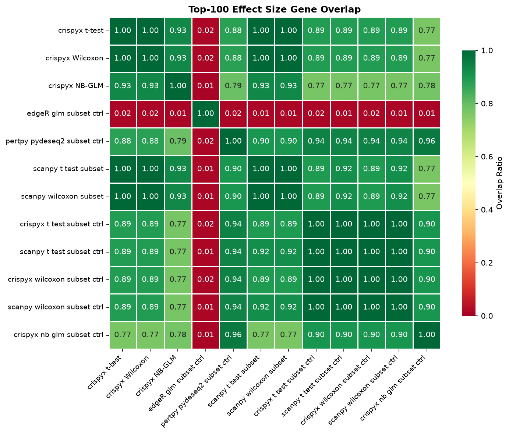
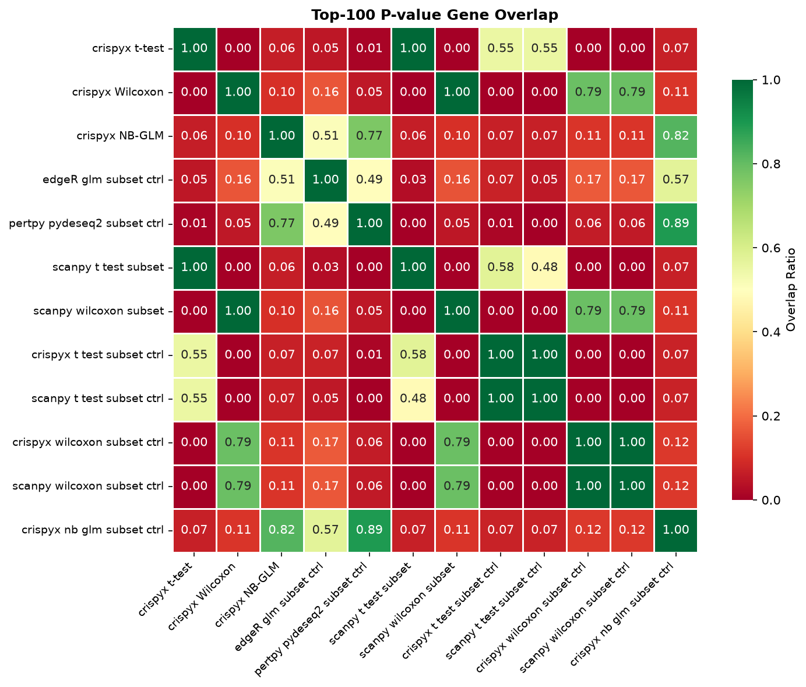

# Benchmark Results

## 1. Performance

### Preprocessing / QC

| Package | Method | Status | Total (s) | Memory (MB) | Cells | Genes |
| --- | --- | --- | --- | --- | --- | --- |
| crispyx | QC filter | success | 5079.44 | 3472.38 | 3359635.0 | 36326.0 |
| scanpy | QC filter | memory_limit | 1292.23 | 67301.8 |  |  |
| crispyx | pseudobulk (avg log) | success | 4485.62 | 36495.34 |  |  |
| crispyx | pseudobulk | success | 2432.73 | 19233.8 |  |  |

### DE: t-test

| Package | Method | Status | Total (s) | Memory (MB) | Groups |
| --- | --- | --- | --- | --- | --- |
| scanpy | t-test | memory_limit | 1466.94 | 66043.45 |  |
| crispyx | t-test | success | 5633.62 | 12917.84 | 16482.0 |

### DE: Wilcoxon

| Package | Method | Status | Total (s) | Memory (MB) | Groups |
| --- | --- | --- | --- | --- | --- |
| crispyx | Wilcoxon | success | 15882.41 | 74009.21 | 16482.0 |
| scanpy | Wilcoxon | memory_limit | 474.28 | 66045.66 |  |

### DE: NB GLM

| Package | Method | Status | Total (s) | Memory (MB) | Groups |
| --- | --- | --- | --- | --- | --- |
| crispyx | NB-GLM | success | 16972.92 | 2094.7 | 16482 |

### Other

| Package | Method | Status | Total (s) | Memory (MB) | Groups |
| --- | --- | --- | --- | --- | --- |
| crispyx | preprocess | success | 2234.69 | 2045.64 |  |
| crispyx | standardize csr | success | 2.36 | 1053.52 |  |

## 2. Performance Comparison

### crispyx vs Reference Tools

_crispyx as baseline. Negative values = crispyx is faster/uses less memory._

#### DE: t-test

| crispyx method | compared to | Time Δ | Time % |  | Mem Δ | Mem % |   |
| --- | --- | --- | --- | --- | --- | --- | --- |
| t-test | scanpy t-test (subset) | +1955.7s | 153.2% | ❌ | -8644.9 MB | 59.9% | ✅ |
| t-test (subset, capped control) | scanpy t-test (subset, capped control) | -11.3s | 45.4% | ✅ | -85.5 MB | 97.3% | ⚠️ |

#### DE: Wilcoxon

| crispyx method | compared to | Time Δ | Time % |  | Mem Δ | Mem % |   |
| --- | --- | --- | --- | --- | --- | --- | --- |
| Wilcoxon | scanpy Wilcoxon (subset) | -54691.8s | 22.5% | ✅ | +52626.3 MB | 346.1% | ❌ |
| Wilcoxon (subset, capped control) | scanpy Wilcoxon (subset, capped control) | -5242.1s | 0.8% | ✅ | +30.6 MB | 101.0% | ⚠️ |

#### DE: NB GLM

| crispyx method | compared to | Time Δ | Time % |  | Mem Δ | Mem % |   |
| --- | --- | --- | --- | --- | --- | --- | --- |
| NB-GLM (subset, capped control) | edgeR NB-GLM (subset, capped control) | -76443.7s | 0.2% | ✅ | +234.8 MB | 121.0% | ❌ |
| NB-GLM (subset, capped control) | pertpy NB-GLM (subset, capped control) | -10172.1s | 1.7% | ✅ | -145780.9 MB | 0.9% | ✅ |

### Tool Comparisons

_Comparisons between external tools._

| package A | method A | package B | method B | Time Δ (A-B) | Time % (A/B) |  | Mem Δ (A-B) | Mem % (A/B) |   |
| --- | --- | --- | --- | --- | --- | --- | --- | --- | --- |
| edgeR | NB-GLM (subset, capped control) | pertpy | NB-GLM (subset, capped control) | +66271.6s | 740.7% | ❌ | -146015.7 MB | 0.8% | ✅ |

## 3. Accuracy

_Correlation metrics between crispyx and reference methods. ✅ >0.95, ⚠️ 0.8-0.95, ❌ <0.8_

### DE: t-test

| crispyx method | compared to | Eff ρ |  | Eff ρₛ |   | Stat ρ |    | Stat ρₛ |     | log-Pval ρ |      | log-Pval ρₛ |       |
| --- | --- | --- | --- | --- | --- | --- | --- | --- | --- | --- | --- | --- | --- |
| t-test | scanpy t-test (subset) | 1.000 <small>±0.000</small> | ✅ | 1.000 <small>±0.000</small> | ✅ | 1.000 <small>±0.000</small> | ✅ | 1.000 <small>±0.000</small> | ✅ | 1.000 <small>±0.000</small> | ✅ | 1.000 <small>±0.000</small> | ✅ |
| t-test (subset, capped control) | scanpy t-test (subset, capped control) | 1.000 <small>±0.000</small> | ✅ | 1.000 <small>±0.000</small> | ✅ | 1.000 <small>±0.000</small> | ✅ | 1.000 <small>±0.000</small> | ✅ | 1.000 <small>±0.000</small> | ✅ | 1.000 <small>±0.000</small> | ✅ |

### DE: Wilcoxon

| crispyx method | compared to | Eff ρ |  | Eff ρₛ |   | Stat ρ |    | Stat ρₛ |     | log-Pval ρ |      | log-Pval ρₛ |       |
| --- | --- | --- | --- | --- | --- | --- | --- | --- | --- | --- | --- | --- | --- |
| Wilcoxon | scanpy Wilcoxon (subset) | 1.000 <small>±0.000</small> | ✅ | 1.000 <small>±0.000</small> | ✅ | 1.000 <small>±0.000</small> | ✅ | 1.000 <small>±0.000</small> | ✅ | 1.000 <small>±0.000</small> | ✅ | 1.000 <small>±0.000</small> | ✅ |
| Wilcoxon (subset, capped control) | scanpy Wilcoxon (subset, capped control) | 1.000 <small>±0.000</small> | ✅ | 1.000 <small>±0.000</small> | ✅ | 1.000 <small>±0.000</small> | ✅ | 1.000 <small>±0.000</small> | ✅ | 1.000 <small>±0.000</small> | ✅ | 1.000 <small>±0.000</small> | ✅ |

### DE: NB GLM

| crispyx method | compared to | Eff ρ |  | Eff ρₛ |   | Stat ρ |    | Stat ρₛ |     | log-Pval ρ |      | log-Pval ρₛ |       |
| --- | --- | --- | --- | --- | --- | --- | --- | --- | --- | --- | --- | --- | --- |
| NB-GLM (subset, capped control) | edgeR NB-GLM (subset, capped control) | 0.494 <small>±0.069</small> | ❌ | 0.870 <small>±0.035</small> | ⚠️ | 0.247 <small>±0.043</small> | ❌ | 0.239 <small>±0.075</small> | ❌ | 0.855 <small>±0.119</small> | ⚠️ | 0.983 <small>±0.003</small> | ✅ |
| NB-GLM (subset, capped control) | pertpy NB-GLM (subset, capped control) | 0.989 <small>±0.012</small> | ✅ | 0.999 <small>±0.001</small> | ✅ | 0.997 <small>±0.001</small> | ✅ | 0.999 <small>±0.001</small> | ✅ | 0.986 <small>±0.016</small> | ✅ | 0.998 <small>±0.001</small> | ✅ |

### Tool Comparisons

| package A | method A | package B | method B | Eff ρ |  | Eff ρₛ |   | Stat ρ |    | Stat ρₛ |     | log-Pval ρ |      | log-Pval ρₛ |       |
| --- | --- | --- | --- | --- | --- | --- | --- | --- | --- | --- | --- | --- | --- | --- | --- |
| edgeR | NB-GLM (subset, capped control) | pertpy | NB-GLM (subset, capped control) | 0.183 <small>±0.058</small> | ❌ | 0.586 <small>±0.039</small> | ❌ | 0.206 <small>±0.037</small> | ❌ | -0.031 <small>±0.033</small> | ❌ | 0.757 <small>±0.111</small> | ❌ | 0.778 <small>±0.024</small> | ❌ |

## 4. Gene Set Overlap

_Overlap ratio of top-k DE genes between methods. ✅ >0.7, ⚠️ 0.5-0.7, ❌ <0.5_

### Effect Size Overlap

| crispyx method | compared to | Top-50 |  | Top-100 |   | Top-500 |    |
| --- | --- | --- | --- | --- | --- | --- | --- |
| t-test | scanpy t-test (subset) | 1.000 | ✅ | 1.000 | ✅ | 1.000 | ✅ |
| t-test (subset, capped control) | scanpy t-test (subset, capped control) | 1.000 | ✅ | 1.000 | ✅ | 1.000 | ✅ |
| Wilcoxon | scanpy Wilcoxon (subset) | 1.000 | ✅ | 1.000 | ✅ | 1.000 | ✅ |
| Wilcoxon (subset, capped control) | scanpy Wilcoxon (subset, capped control) | 1.000 | ✅ | 1.000 | ✅ | 1.000 | ✅ |
| NB-GLM (subset, capped control) | edgeR NB-GLM (subset, capped control) | 0.015 | ❌ | 0.011 | ❌ | 0.022 | ❌ |
| NB-GLM (subset, capped control) | pertpy NB-GLM (subset, capped control) | 0.949 | ✅ | 0.964 | ✅ | 0.977 | ✅ |

### P-value Overlap

| crispyx method | compared to | Top-50 |  | Top-100 |   | Top-500 |    |
| --- | --- | --- | --- | --- | --- | --- | --- |
| t-test | scanpy t-test (subset) | 1.000 | ✅ | 1.000 | ✅ | 1.000 | ✅ |
| t-test (subset, capped control) | scanpy t-test (subset, capped control) | 1.000 | ✅ | 1.000 | ✅ | 1.000 | ✅ |
| Wilcoxon | scanpy Wilcoxon (subset) | 1.000 | ✅ | 1.000 | ✅ | 1.000 | ✅ |
| Wilcoxon (subset, capped control) | scanpy Wilcoxon (subset, capped control) | 1.000 | ✅ | 1.000 | ✅ | 1.000 | ✅ |
| NB-GLM (subset, capped control) | edgeR NB-GLM (subset, capped control) | 0.524 | ⚠️ | 0.572 | ⚠️ | 0.704 | ✅ |
| NB-GLM (subset, capped control) | pertpy NB-GLM (subset, capped control) | 0.882 | ✅ | 0.892 | ✅ | 0.929 | ✅ |

_Note: Some methods are missing due to errors:_
- t-test vs scanpy t-test: _missing output: scanpy_de_t_test (no output file)_
- Wilcoxon vs scanpy Wilcoxon: _missing output: scanpy_de_wilcoxon (no output file)_
- NB-GLM vs pertpy NB-GLM (subset): _missing output: pertpy_de_pydeseq2_subset (no output file)_
- NB-GLM vs edgeR NB-GLM (subset): _missing output: edger_de_glm_subset (no output file)_

### Overlap Heatmaps (Top-100)

#### Effect Size

#### P-value

---

**Legend:**
- **Performance:** ✅ >10% better | ⚠️ within ±10% | ❌ >10% worse
- **Accuracy:** ✅ ρ≥0.95 | ⚠️ 0.8≤ρ<0.95 | ❌ ρ<0.8
- **Overlap:** ✅ ≥0.7 | ⚠️ 0.5-0.7 | ❌ <0.5
- **Shrinkage:** ✅ <1% inflated | ⚠️ 1-10% inflated | ❌ >10% inflated

**Abbreviations:**
- ρ = Pearson correlation, ρₛ = Spearman correlation
- log-Pval = correlations on -log₁₀(p) transformed values
- sf=per = per-comparison size factor estimation (matches PyDESeq2)

**Notes:**
- Correlation and overlap values shown as mean±std across perturbations
- crispyx lfcShrink uses `method='stats'` (Gaussian approximation) which is numerically stable and ~35× faster than `method='full'`.
- P-value overlap excludes lfcShrink methods since shrinkage only affects effect sizes, not p-values.
- **Warning:** PyDESeq2 may produce aberrant shrinkage when dispersion trend fitting fails. crispyx shrinkage is more robust.

## Accuracy subset

Accuracy metrics use the same 50 seeded perturbations (seed 0) for every method; the list is in `.accuracy_perturbations.json`.

Reruns on that subset, for accuracy only: they are not performance rows, and their time and memory (kept in `benchmark_accuracy_reruns.csv` for the record) are not compared. Performance uses the full-data runs, where a failure (timeout, memory limit) is the result. `_subset` = full control; `_subset_ctrl` = control capped, crispyx rerun on the same cells.

Control: 165,777 cells, cap 20,000. By the rule (decided by the control's size, not by which runs fit on a machine), this dataset's primary accuracy comparisons use the **capped** control (`_subset_ctrl` pairs, every method on the same cells); comparisons on the full control are supplementary.

| method | status | perturbations | control cells |
| --- | --- | --- | --- |
| crispyx_de_nb_glm_subset_ctrl | success | 50.0 |  |
| crispyx_de_t_test_subset_ctrl | success | 50.0 |  |
| crispyx_de_wilcoxon_subset_ctrl | success | 50.0 |  |
| edger_de_glm_subset | error | nan |  |
| edger_de_glm_subset_ctrl | success | 50.0 | 20,000 |
| pertpy_de_pydeseq2_subset | error | nan |  |
| pertpy_de_pydeseq2_subset_ctrl | success | 50.0 | 20,000 |
| scanpy_de_t_test_subset | success | 50.0 |  |
| scanpy_de_t_test_subset_ctrl | success | 50.0 | 20,000 |
| scanpy_de_wilcoxon_subset | success | 50.0 |  |
| scanpy_de_wilcoxon_subset_ctrl | success | 50.0 | 20,000 |
