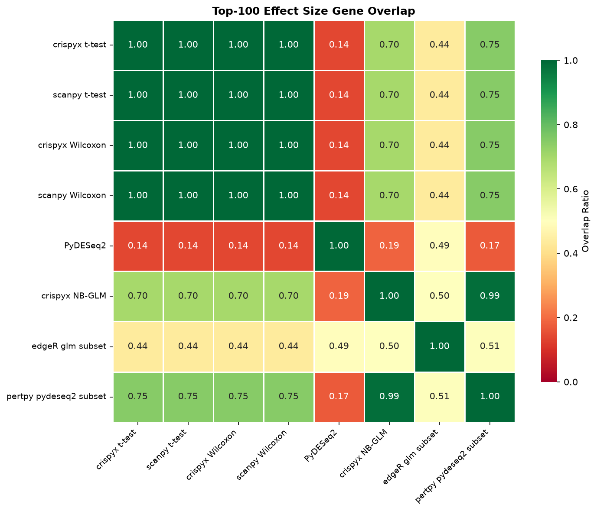
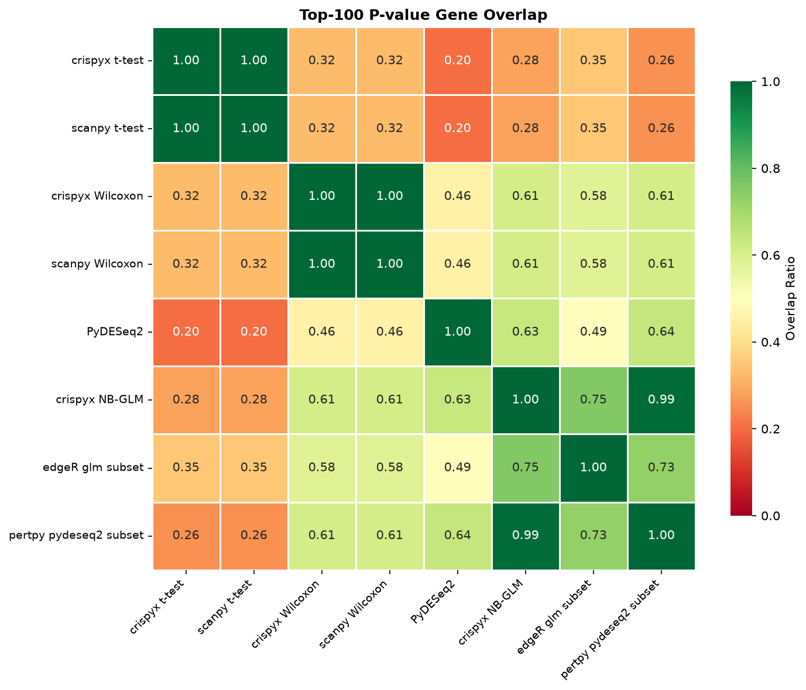

# Benchmark Results

## 1. Performance

### Preprocessing / QC

| Package | Method | Status | Total (s) | Memory (MB) | Cells | Genes |
| --- | --- | --- | --- | --- | --- | --- |
| crispyx | QC filter | success | 12.9 | 13931.5 | 142281.0 | 9624.0 |
| scanpy | QC filter | success | 31.29 | 21350.45 | 142281.0 | 9624.0 |
| crispyx | pseudobulk (avg log) | success | 43.82 | 3138.53 |  |  |
| crispyx | pseudobulk | success | 22.84 | 2005.73 |  |  |

### DE: t-test

| Package | Method | Status | Total (s) | Memory (MB) | Groups |
| --- | --- | --- | --- | --- | --- |
| scanpy | t-test | success | 198.16 | 8618.28 | 2160 |
| crispyx | t-test | success | 43.18 | 1047.23 | 2160 |

### DE: Wilcoxon

| Package | Method | Status | Total (s) | Memory (MB) | Groups |
| --- | --- | --- | --- | --- | --- |
| crispyx | Wilcoxon | success | 89.66 | 9766.05 | 2160 |
| scanpy | Wilcoxon | success | 11588.15 | 8753.84 | 2160 |

### DE: NB GLM

| Package | Method | Status | Total (s) | Memory (MB) | Groups |
| --- | --- | --- | --- | --- | --- |
| crispyx | NB-GLM | success | 671.91 | 754.93 | 2160.0 |
| edgeR | NB-GLM | timeout | 21605.11 |  |  |
| pertpy | NB-GLM | success | 27145.57 | 16331.96 | 2160.0 |

### Other

| Package | Method | Status | Total (s) | Memory (MB) | Groups |
| --- | --- | --- | --- | --- | --- |
| crispyx | preprocess | success | 49.73 | 634.84 |  |
| crispyx | standardize csr | success | 1.03 | 243.33 |  |

## 2. Performance Comparison

### crispyx vs Reference Tools

_crispyx as baseline. Negative values = crispyx is faster/uses less memory._

#### Preprocessing / QC

| crispyx method | compared to | Time Δ | Time % |  | Mem Δ | Mem % |   |
| --- | --- | --- | --- | --- | --- | --- | --- |
| QC filter | scanpy QC filter | -18.4s | 41.2% | ✅ | -7419.0 MB | 65.3% | ✅ |

#### DE: t-test

| crispyx method | compared to | Time Δ | Time % |  | Mem Δ | Mem % |   |
| --- | --- | --- | --- | --- | --- | --- | --- |
| t-test | scanpy t-test | -155.0s | 21.8% | ✅ | -7571.1 MB | 12.2% | ✅ |

#### DE: Wilcoxon

| crispyx method | compared to | Time Δ | Time % |  | Mem Δ | Mem % |   |
| --- | --- | --- | --- | --- | --- | --- | --- |
| Wilcoxon | scanpy Wilcoxon | -11498.5s | 0.8% | ✅ | +1012.2 MB | 111.6% | ❌ |

#### DE: NB GLM

| crispyx method | compared to | Time Δ | Time % |  | Mem Δ | Mem % |   |
| --- | --- | --- | --- | --- | --- | --- | --- |
| NB-GLM | edgeR NB-GLM (subset) | +176.0s | 135.5% | ❌ | +341.4 MB | 182.5% | ❌ |
| NB-GLM | pertpy NB-GLM (subset) | -293.9s | 69.6% | ✅ | -11270.6 MB | 6.3% | ✅ |

### Tool Comparisons

_Comparisons between external tools._

| package A | method A | package B | method B | Time Δ (A-B) | Time % (A/B) |  | Mem Δ (A-B) | Mem % (A/B) |   |
| --- | --- | --- | --- | --- | --- | --- | --- | --- | --- |
| edgeR | NB-GLM (subset) | pertpy | NB-GLM (subset) | -469.8s | 51.4% | ✅ | -11612.0 MB | 3.4% | ✅ |

## 3. Accuracy

_Correlation metrics between crispyx and reference methods. ✅ >0.95, ⚠️ 0.8-0.95, ❌ <0.8_

### Preprocessing / QC

| crispyx method | compared to | Cells Δ |  | Genes Δ |   |
| --- | --- | --- | --- | --- | --- |
| QC filter | scanpy QC filter | +0 | ✅ | +0 | ✅ |

### DE: t-test

| crispyx method | compared to | Eff ρ |  | Eff ρₛ |   | Stat ρ |    | Stat ρₛ |     | log-Pval ρ |      | log-Pval ρₛ |       |
| --- | --- | --- | --- | --- | --- | --- | --- | --- | --- | --- | --- | --- | --- |
| t-test | scanpy t-test | 1.000 <small>±0.000</small> | ✅ | 1.000 <small>±0.000</small> | ✅ | 1.000 <small>±0.000</small> | ✅ | 1.000 <small>±0.000</small> | ✅ | 1.000 <small>±0.000</small> | ✅ | 1.000 <small>±0.000</small> | ✅ |

### DE: Wilcoxon

| crispyx method | compared to | Eff ρ |  | Eff ρₛ |   | Stat ρ |    | Stat ρₛ |     | log-Pval ρ |      | log-Pval ρₛ |       |
| --- | --- | --- | --- | --- | --- | --- | --- | --- | --- | --- | --- | --- | --- |
| Wilcoxon | scanpy Wilcoxon | 1.000 <small>±0.000</small> | ✅ | 1.000 <small>±0.000</small> | ✅ | 1.000 <small>±0.000</small> | ✅ | 1.000 <small>±0.000</small> | ✅ | 1.000 <small>±0.000</small> | ✅ | 1.000 <small>±0.000</small> | ✅ |

### DE: NB GLM

| crispyx method | compared to | Eff ρ |  | Eff ρₛ |   | Stat ρ |    | Stat ρₛ |     | log-Pval ρ |      | log-Pval ρₛ |       |
| --- | --- | --- | --- | --- | --- | --- | --- | --- | --- | --- | --- | --- | --- |
| NB-GLM | edgeR NB-GLM (subset) | 0.962 <small>±0.007</small> | ✅ | 0.993 <small>±0.001</small> | ✅ | 0.773 <small>±0.097</small> | ❌ | 0.978 <small>±0.004</small> | ✅ | 0.936 <small>±0.056</small> | ⚠️ | 0.990 <small>±0.004</small> | ✅ |
| NB-GLM | pertpy NB-GLM (subset) | 0.990 <small>±0.028</small> | ✅ | 0.999 <small>±0.001</small> | ✅ | 0.999 <small>±0.003</small> | ✅ | 0.999 <small>±0.001</small> | ✅ | 0.995 <small>±0.024</small> | ✅ | 0.999 <small>±0.001</small> | ✅ |

### Tool Comparisons

| package A | method A | package B | method B | Eff ρ |  | Eff ρₛ |   | Stat ρ |    | Stat ρₛ |     | log-Pval ρ |      | log-Pval ρₛ |       |
| --- | --- | --- | --- | --- | --- | --- | --- | --- | --- | --- | --- | --- | --- | --- | --- |
| edgeR | NB-GLM (subset) | pertpy | NB-GLM (subset) | 0.748 <small>±0.141</small> | ❌ | 0.992 <small>±0.001</small> | ✅ | 0.738 <small>±0.097</small> | ❌ | 0.967 <small>±0.016</small> | ✅ | 0.917 <small>±0.063</small> | ⚠️ | 0.979 <small>±0.015</small> | ✅ |

## 4. Gene Set Overlap

_Overlap ratio of top-k DE genes between methods. ✅ >0.7, ⚠️ 0.5-0.7, ❌ <0.5_

### Effect Size Overlap

| crispyx method | compared to | Top-50 |  | Top-100 |   | Top-500 |    |
| --- | --- | --- | --- | --- | --- | --- | --- |
| t-test | scanpy t-test | 1.000 | ✅ | 1.000 | ✅ | 1.000 | ✅ |
| Wilcoxon | scanpy Wilcoxon | 1.000 | ✅ | 1.000 | ✅ | 1.000 | ✅ |
| NB-GLM | edgeR NB-GLM (subset) | 0.437 | ❌ | 0.500 | ⚠️ | 0.697 | ⚠️ |
| NB-GLM | pertpy NB-GLM (subset) | 0.982 | ✅ | 0.987 | ✅ | 0.996 | ✅ |

### P-value Overlap

| crispyx method | compared to | Top-50 |  | Top-100 |   | Top-500 |    |
| --- | --- | --- | --- | --- | --- | --- | --- |
| t-test | scanpy t-test | 1.000 | ✅ | 1.000 | ✅ | 1.000 | ✅ |
| Wilcoxon | scanpy Wilcoxon | 1.000 | ✅ | 1.000 | ✅ | 1.000 | ✅ |
| NB-GLM | edgeR NB-GLM (subset) | 0.718 | ✅ | 0.755 | ✅ | 0.829 | ✅ |
| NB-GLM | pertpy NB-GLM (subset) | 0.984 | ✅ | 0.990 | ✅ | 0.995 | ✅ |

_Note: Some methods are missing due to errors:_
- t-test vs scanpy t-test (subset): _missing output: scanpy_de_t_test_subset (not run, no output)_
- Wilcoxon vs scanpy Wilcoxon (subset): _missing output: scanpy_de_wilcoxon_subset (not run, no output)_
- t-test (subset, capped control) vs scanpy t-test (subset, capped control): _missing output: crispyx_de_t_test_subset_ctrl (not run, no output), scanpy_de_t_test_subset_ctrl (not run, no output)_
- Wilcoxon (subset, capped control) vs scanpy Wilcoxon (subset, capped control): _missing output: crispyx_de_wilcoxon_subset_ctrl (not run, no output), scanpy_de_wilcoxon_subset_ctrl (not run, no output)_
- NB-GLM (subset, capped control) vs pertpy NB-GLM (subset, capped control): _missing output: crispyx_de_nb_glm_subset_ctrl (not run, no output), pertpy_de_pydeseq2_subset_ctrl (not run, no output)_
- NB-GLM (subset, capped control) vs edgeR NB-GLM (subset, capped control): _missing output: crispyx_de_nb_glm_subset_ctrl (not run, no output), edger_de_glm_subset_ctrl (not run, no output)_

### Overlap Heatmaps (Top-100)

#### Effect Size

#### P-value

---

**Legend:**
- **Performance:** ✅ >10% better | ⚠️ within ±10% | ❌ >10% worse
- **Accuracy:** ✅ ρ≥0.95 | ⚠️ 0.8≤ρ<0.95 | ❌ ρ<0.8
- **Overlap:** ✅ ≥0.7 | ⚠️ 0.5-0.7 | ❌ <0.5
- **Shrinkage:** ✅ <1% inflated | ⚠️ 1-10% inflated | ❌ >10% inflated

**Abbreviations:**
- ρ = Pearson correlation, ρₛ = Spearman correlation
- log-Pval = correlations on -log₁₀(p) transformed values
- sf=per = per-comparison size factor estimation (matches PyDESeq2)

**Notes:**
- Correlation and overlap values shown as mean±std across perturbations
- crispyx lfcShrink uses `method='stats'` (Gaussian approximation) which is numerically stable and ~35× faster than `method='full'`.
- P-value overlap excludes lfcShrink methods since shrinkage only affects effect sizes, not p-values.
- **Warning:** PyDESeq2 may produce aberrant shrinkage when dispersion trend fitting fails. crispyx shrinkage is more robust.

## Accuracy subset

Accuracy metrics use the same 50 seeded perturbations (seed 0) for every method; the list is in `.accuracy_perturbations.json`.

Reruns on that subset, for accuracy only: they are not performance rows, and their time and memory (kept in `benchmark_accuracy_reruns.csv` for the record) are not compared. Performance uses the full-data runs, where a failure (timeout, memory limit) is the result. `_subset` = full control; `_subset_ctrl` = control capped, crispyx rerun on the same cells.

Control: 4,976 cells, cap 20,000. By the rule (decided by the control's size, not by which runs fit on a machine), this dataset's primary accuracy comparisons use the **full** control (the cap does not bind).

| method | status | perturbations | control cells |
| --- | --- | --- | --- |
| edger_de_glm_subset | success | 50.0 | 4,976 |
| pertpy_de_pydeseq2_subset | success | 50.0 | 4,976 |
