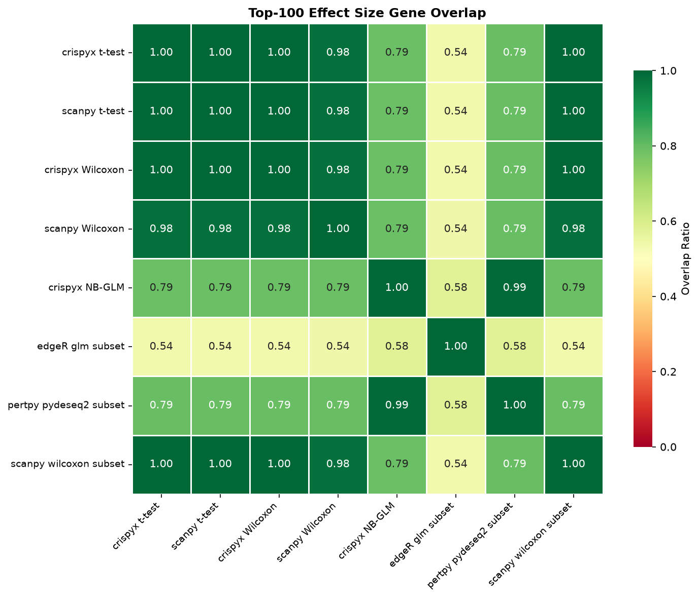
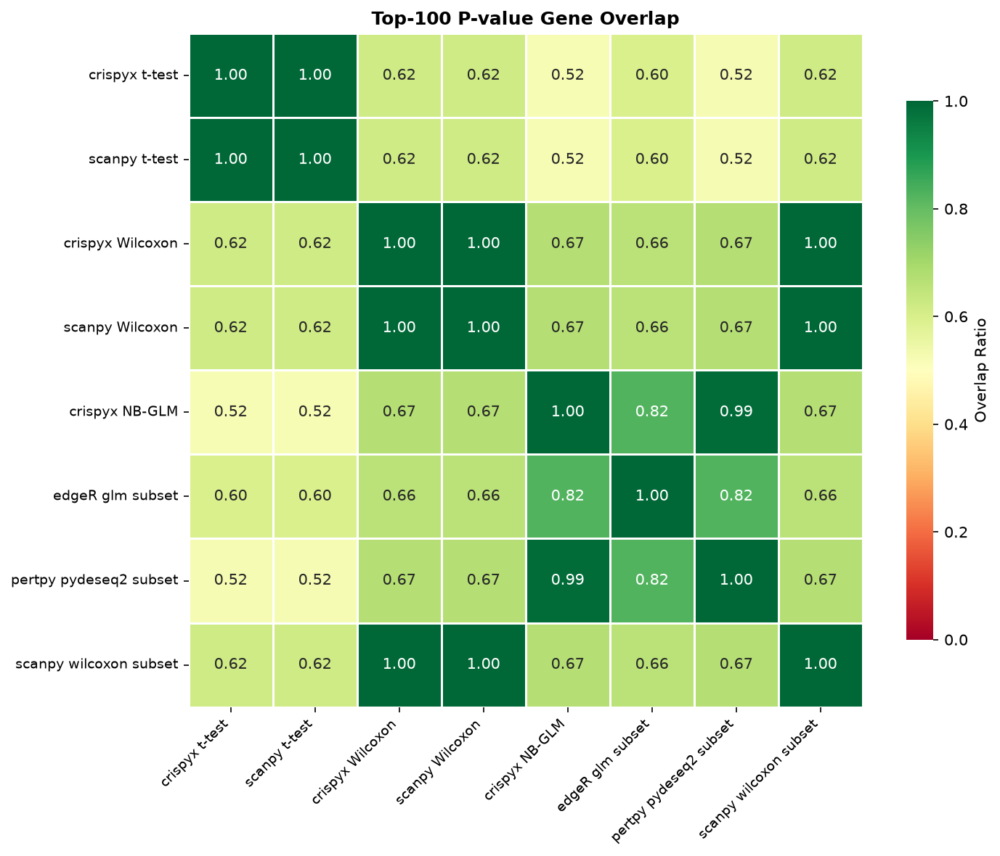

# Benchmark Results

## 1. Performance

### Preprocessing / QC

| Package | Method | Status | Total (s) | Memory (MB) | Cells | Genes |
| --- | --- | --- | --- | --- | --- | --- |
| crispyx | QC filter | success | 22.88 | 25854.73 | 304114.0 | 8563.0 |
| scanpy | QC filter | success | 115.24 | 40464.89 | 304114.0 | 8563.0 |
| crispyx | pseudobulk (avg log) | success | 81.73 | 2791.16 |  |  |
| crispyx | pseudobulk | success | 39.5 | 1890.68 |  |  |

### DE: t-test

| Package | Method | Status | Total (s) | Memory (MB) | Groups |
| --- | --- | --- | --- | --- | --- |
| scanpy | t-test | success | 131.82 | 14471.71 | 1853 |
| crispyx | t-test | success | 67.08 | 974.85 | 1853 |

### DE: Wilcoxon

| Package | Method | Status | Total (s) | Memory (MB) | Groups |
| --- | --- | --- | --- | --- | --- |
| crispyx | Wilcoxon | success | 157.28 | 19291.2 | 1853.0 |
| scanpy | Wilcoxon | recovered | 21605.1 |  |  |

### DE: NB GLM

| Package | Method | Status | Total (s) | Memory (MB) | Groups |
| --- | --- | --- | --- | --- | --- |
| crispyx | NB-GLM | success | 627.48 | 826.95 | 1853.0 |
| edgeR | NB-GLM | timeout | 21605.12 |  |  |
| pertpy | NB-GLM | timeout | 21606.59 |  |  |

### Other

| Package | Method | Status | Total (s) | Memory (MB) | Groups |
| --- | --- | --- | --- | --- | --- |
| crispyx | preprocess | success | 93.82 | 827.16 |  |
| crispyx | standardize csr | success | 1.03 | 342.69 |  |

## 2. Performance Comparison

### crispyx vs Reference Tools

_crispyx as baseline. Negative values = crispyx is faster/uses less memory._

#### Preprocessing / QC

| crispyx method | compared to | Time Δ | Time % |  | Mem Δ | Mem % |   |
| --- | --- | --- | --- | --- | --- | --- | --- |
| QC filter | scanpy QC filter | -92.4s | 19.9% | ✅ | -14610.2 MB | 63.9% | ✅ |

#### DE: t-test

| crispyx method | compared to | Time Δ | Time % |  | Mem Δ | Mem % |   |
| --- | --- | --- | --- | --- | --- | --- | --- |
| t-test | scanpy t-test | -64.7s | 50.9% | ✅ | -13496.9 MB | 6.7% | ✅ |

#### DE: Wilcoxon

| crispyx method | compared to | Time Δ | Time % |  | Mem Δ | Mem % |   |
| --- | --- | --- | --- | --- | --- | --- | --- |
| Wilcoxon | scanpy Wilcoxon | -21447.8s | 0.7% | ✅ | - | - |  |
| Wilcoxon | scanpy Wilcoxon (subset) | -520.0s | 23.2% | ✅ | +17636.8 MB | 1166.1% | ❌ |

#### DE: NB GLM

| crispyx method | compared to | Time Δ | Time % |  | Mem Δ | Mem % |   |
| --- | --- | --- | --- | --- | --- | --- | --- |
| NB-GLM | edgeR NB-GLM (subset) | -388.0s | 61.8% | ✅ | +416.3 MB | 201.4% | ❌ |
| NB-GLM | pertpy NB-GLM (subset) | -813.0s | 43.6% | ✅ | -21696.8 MB | 3.7% | ✅ |

### Tool Comparisons

_Comparisons between external tools._

| package A | method A | package B | method B | Time Δ (A-B) | Time % (A/B) |  | Mem Δ (A-B) | Mem % (A/B) |   |
| --- | --- | --- | --- | --- | --- | --- | --- | --- | --- |
| edgeR | NB-GLM (subset) | pertpy | NB-GLM (subset) | -425.1s | 70.5% | ✅ | -22113.1 MB | 1.8% | ✅ |

## 3. Accuracy

_Correlation metrics between crispyx and reference methods. ✅ >0.95, ⚠️ 0.8-0.95, ❌ <0.8_

### Preprocessing / QC

| crispyx method | compared to | Cells Δ |  | Genes Δ |   |
| --- | --- | --- | --- | --- | --- |
| QC filter | scanpy QC filter | +0 | ✅ | +0 | ✅ |

### DE: t-test

| crispyx method | compared to | Eff ρ |  | Eff ρₛ |   | Stat ρ |    | Stat ρₛ |     | log-Pval ρ |      | log-Pval ρₛ |       |
| --- | --- | --- | --- | --- | --- | --- | --- | --- | --- | --- | --- | --- | --- |
| t-test | scanpy t-test | 1.000 <small>±0.000</small> | ✅ | 1.000 <small>±0.000</small> | ✅ | 1.000 <small>±0.000</small> | ✅ | 1.000 <small>±0.000</small> | ✅ | 1.000 <small>±0.000</small> | ✅ | 1.000 <small>±0.000</small> | ✅ |

### DE: Wilcoxon

| crispyx method | compared to | Eff ρ |  | Eff ρₛ |   | Stat ρ |    | Stat ρₛ |     | log-Pval ρ |      | log-Pval ρₛ |       |
| --- | --- | --- | --- | --- | --- | --- | --- | --- | --- | --- | --- | --- | --- |
| Wilcoxon | scanpy Wilcoxon | 1.000 <small>±0.000</small> | ✅ | 1.000 <small>±0.000</small> | ✅ | 1.000 <small>±0.000</small> | ✅ | 1.000 <small>±0.000</small> | ✅ | 1.000 <small>±0.000</small> | ✅ | 1.000 <small>±0.000</small> | ✅ |
| Wilcoxon | scanpy Wilcoxon (subset) | 1.000 <small>±0.000</small> | ✅ | 1.000 <small>±0.000</small> | ✅ | 1.000 <small>±0.000</small> | ✅ | 1.000 <small>±0.000</small> | ✅ | 1.000 <small>±0.000</small> | ✅ | 1.000 <small>±0.000</small> | ✅ |

### DE: NB GLM

| crispyx method | compared to | Eff ρ |  | Eff ρₛ |   | Stat ρ |    | Stat ρₛ |     | log-Pval ρ |      | log-Pval ρₛ |       |
| --- | --- | --- | --- | --- | --- | --- | --- | --- | --- | --- | --- | --- | --- |
| NB-GLM | edgeR NB-GLM (subset) | 0.969 <small>±0.006</small> | ✅ | 0.993 <small>±0.001</small> | ✅ | -0.001 <small>±0.215</small> | ❌ | 0.002 <small>±0.188</small> | ❌ | 0.965 <small>±0.077</small> | ✅ | 0.997 <small>±0.001</small> | ✅ |
| NB-GLM | pertpy NB-GLM (subset) | 0.998 <small>±0.004</small> | ✅ | 1.000 <small>±0.000</small> | ✅ | 1.000 <small>±0.001</small> | ✅ | 1.000 <small>±0.000</small> | ✅ | 0.997 <small>±0.012</small> | ✅ | 1.000 <small>±0.000</small> | ✅ |

### Tool Comparisons

| package A | method A | package B | method B | Eff ρ |  | Eff ρₛ |   | Stat ρ |    | Stat ρₛ |     | log-Pval ρ |      | log-Pval ρₛ |       |
| --- | --- | --- | --- | --- | --- | --- | --- | --- | --- | --- | --- | --- | --- | --- | --- |
| edgeR | NB-GLM (subset) | pertpy | NB-GLM (subset) | 0.951 <small>±0.044</small> | ✅ | 0.993 <small>±0.002</small> | ✅ | -0.004 <small>±0.215</small> | ❌ | 0.002 <small>±0.188</small> | ❌ | 0.962 <small>±0.084</small> | ✅ | 0.997 <small>±0.001</small> | ✅ |

## 4. Gene Set Overlap

_Overlap ratio of top-k DE genes between methods. ✅ >0.7, ⚠️ 0.5-0.7, ❌ <0.5_

### Effect Size Overlap

| crispyx method | compared to | Top-50 |  | Top-100 |   | Top-500 |    |
| --- | --- | --- | --- | --- | --- | --- | --- |
| t-test | scanpy t-test | 1.000 | ✅ | 1.000 | ✅ | 1.000 | ✅ |
| Wilcoxon | scanpy Wilcoxon | 0.978 | ✅ | 0.981 | ✅ | 0.981 | ✅ |
| Wilcoxon | scanpy Wilcoxon (subset) | 1.000 | ✅ | 1.000 | ✅ | 1.000 | ✅ |
| NB-GLM | edgeR NB-GLM (subset) | 0.523 | ⚠️ | 0.582 | ⚠️ | 0.718 | ✅ |
| NB-GLM | pertpy NB-GLM (subset) | 0.992 | ✅ | 0.994 | ✅ | 0.998 | ✅ |

### P-value Overlap

| crispyx method | compared to | Top-50 |  | Top-100 |   | Top-500 |    |
| --- | --- | --- | --- | --- | --- | --- | --- |
| t-test | scanpy t-test | 1.000 | ✅ | 1.000 | ✅ | 1.000 | ✅ |
| Wilcoxon | scanpy Wilcoxon | 1.000 | ✅ | 1.000 | ✅ | 1.000 | ✅ |
| Wilcoxon | scanpy Wilcoxon (subset) | 1.000 | ✅ | 1.000 | ✅ | 1.000 | ✅ |
| NB-GLM | edgeR NB-GLM (subset) | 0.809 | ✅ | 0.825 | ✅ | 0.893 | ✅ |
| NB-GLM | pertpy NB-GLM (subset) | 0.991 | ✅ | 0.991 | ✅ | 0.996 | ✅ |

_Note: Some methods are missing due to errors:_
- t-test vs scanpy t-test (subset): _missing output: scanpy_de_t_test_subset (not run, no output)_
- t-test (subset, capped control) vs scanpy t-test (subset, capped control): _missing output: crispyx_de_t_test_subset_ctrl (not run, no output), scanpy_de_t_test_subset_ctrl (not run, no output)_
- Wilcoxon (subset, capped control) vs scanpy Wilcoxon (subset, capped control): _missing output: crispyx_de_wilcoxon_subset_ctrl (not run, no output), scanpy_de_wilcoxon_subset_ctrl (not run, no output)_
- NB-GLM (subset, capped control) vs pertpy NB-GLM (subset, capped control): _missing output: crispyx_de_nb_glm_subset_ctrl (not run, no output), pertpy_de_pydeseq2_subset_ctrl (not run, no output)_
- NB-GLM (subset, capped control) vs edgeR NB-GLM (subset, capped control): _missing output: crispyx_de_nb_glm_subset_ctrl (not run, no output), edger_de_glm_subset_ctrl (not run, no output)_

### Overlap Heatmaps (Top-100)

#### Effect Size

#### P-value

---

**Legend:**
- **Performance:** ✅ >10% better | ⚠️ within ±10% | ❌ >10% worse
- **Accuracy:** ✅ ρ≥0.95 | ⚠️ 0.8≤ρ<0.95 | ❌ ρ<0.8
- **Overlap:** ✅ ≥0.7 | ⚠️ 0.5-0.7 | ❌ <0.5
- **Shrinkage:** ✅ <1% inflated | ⚠️ 1-10% inflated | ❌ >10% inflated

**Abbreviations:**
- ρ = Pearson correlation, ρₛ = Spearman correlation
- log-Pval = correlations on -log₁₀(p) transformed values
- sf=per = per-comparison size factor estimation (matches PyDESeq2)

**Notes:**
- Correlation and overlap values shown as mean±std across perturbations
- crispyx lfcShrink uses `method='stats'` (Gaussian approximation) which is numerically stable and ~35× faster than `method='full'`.
- P-value overlap excludes lfcShrink methods since shrinkage only affects effect sizes, not p-values.
- **Warning:** PyDESeq2 may produce aberrant shrinkage when dispersion trend fitting fails. crispyx shrinkage is more robust.

## Accuracy subset

Accuracy metrics use the same 50 seeded perturbations (seed 0) for every method; the list is in `.accuracy_perturbations.json`.

Reruns on that subset, for accuracy only: they are not performance rows, and their time and memory (kept in `benchmark_accuracy_reruns.csv` for the record) are not compared. Performance uses the full-data runs, where a failure (timeout, memory limit) is the result. `_subset` = full control; `_subset_ctrl` = control capped, crispyx rerun on the same cells.

Control: 10,691 cells, cap 20,000. By the rule (decided by the control's size, not by which runs fit on a machine), this dataset's primary accuracy comparisons use the **full** control (the cap does not bind).

| method | status | perturbations | control cells |
| --- | --- | --- | --- |
| edger_de_glm_subset | success | 50.0 | 10,691 |
| pertpy_de_pydeseq2_subset | success | 50.0 | 10,691 |
| scanpy_de_wilcoxon_subset | success | 50.0 | 10,691 |
