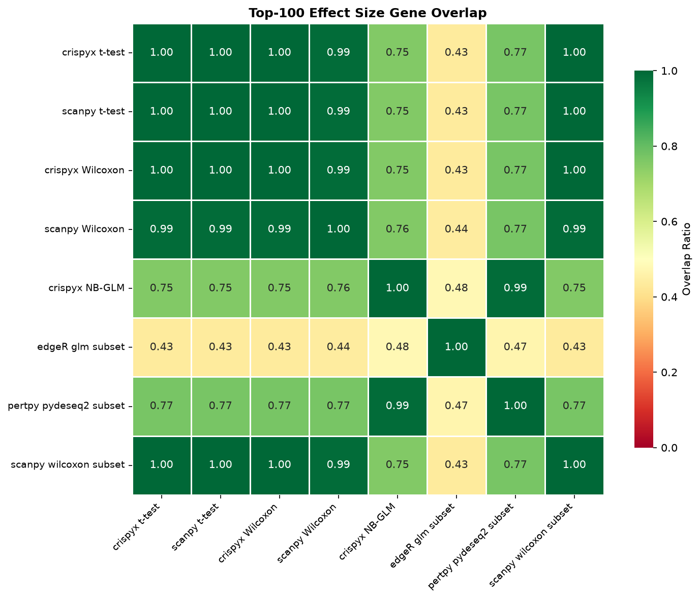
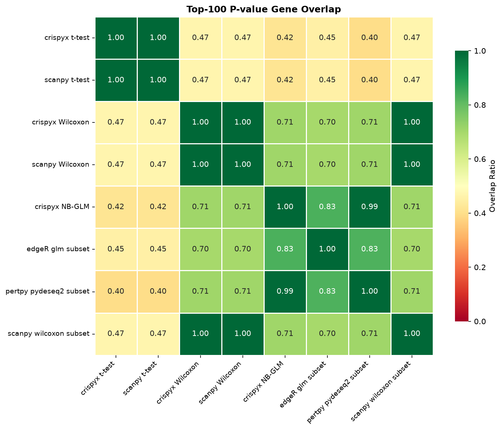

# Benchmark Results

## 1. Performance

### Preprocessing / QC

| Package | Method | Status | Total (s) | Memory (MB) | Cells | Genes |
| --- | --- | --- | --- | --- | --- | --- |
| crispyx | QC filter | success | 17.49 | 20137.82 | 244412.0 | 8749.0 |
| scanpy | QC filter | success | 85.56 | 33264.03 | 244412.0 | 8749.0 |
| crispyx | pseudobulk (avg log) | success | 64.63 | 3004.43 |  |  |
| crispyx | pseudobulk | success | 32.31 | 1972.13 |  |  |

### DE: t-test

| Package | Method | Status | Total (s) | Memory (MB) | Groups |
| --- | --- | --- | --- | --- | --- |
| scanpy | t-test | success | 148.82 | 11475.08 | 2155 |
| crispyx | t-test | success | 57.64 | 1017.87 | 2155 |

### DE: Wilcoxon

| Package | Method | Status | Total (s) | Memory (MB) | Groups |
| --- | --- | --- | --- | --- | --- |
| crispyx | Wilcoxon | success | 135.69 | 15501.25 | 2155.0 |
| scanpy | Wilcoxon | recovered | 21605.1 |  |  |

### DE: NB GLM

| Package | Method | Status | Total (s) | Memory (MB) | Groups |
| --- | --- | --- | --- | --- | --- |
| crispyx | NB-GLM | success | 698.43 | 811.12 | 2155.0 |
| edgeR | NB-GLM | timeout | 21605.11 |  |  |
| pertpy | NB-GLM | timeout | 21605.86 |  |  |

### Other

| Package | Method | Status | Total (s) | Memory (MB) | Groups |
| --- | --- | --- | --- | --- | --- |
| crispyx | preprocess | success | 74.07 | 747.97 |  |
| crispyx | standardize csr | success | 1.03 | 380.36 |  |

## 2. Performance Comparison

### crispyx vs Reference Tools

_crispyx as baseline. Negative values = crispyx is faster/uses less memory._

#### Preprocessing / QC

| crispyx method | compared to | Time Δ | Time % |  | Mem Δ | Mem % |   |
| --- | --- | --- | --- | --- | --- | --- | --- |
| QC filter | scanpy QC filter | -68.1s | 20.4% | ✅ | -13126.2 MB | 60.5% | ✅ |

#### DE: t-test

| crispyx method | compared to | Time Δ | Time % |  | Mem Δ | Mem % |   |
| --- | --- | --- | --- | --- | --- | --- | --- |
| t-test | scanpy t-test | -91.2s | 38.7% | ✅ | -10457.2 MB | 8.9% | ✅ |

#### DE: Wilcoxon

| crispyx method | compared to | Time Δ | Time % |  | Mem Δ | Mem % |   |
| --- | --- | --- | --- | --- | --- | --- | --- |
| Wilcoxon | scanpy Wilcoxon | -21469.4s | 0.6% | ✅ | - | - |  |
| Wilcoxon | scanpy Wilcoxon (subset) | -599.8s | 18.4% | ✅ | +13987.3 MB | 1023.9% | ❌ |

#### DE: NB GLM

| crispyx method | compared to | Time Δ | Time % |  | Mem Δ | Mem % |   |
| --- | --- | --- | --- | --- | --- | --- | --- |
| NB-GLM | edgeR NB-GLM (subset) | -408.7s | 63.1% | ✅ | +401.3 MB | 197.9% | ❌ |
| NB-GLM | pertpy NB-GLM (subset) | -970.3s | 41.9% | ✅ | -23501.4 MB | 3.3% | ✅ |

### Tool Comparisons

_Comparisons between external tools._

| package A | method A | package B | method B | Time Δ (A-B) | Time % (A/B) |  | Mem Δ (A-B) | Mem % (A/B) |   |
| --- | --- | --- | --- | --- | --- | --- | --- | --- | --- |
| edgeR | NB-GLM (subset) | pertpy | NB-GLM (subset) | -561.6s | 66.3% | ✅ | -23902.7 MB | 1.7% | ✅ |

## 3. Accuracy

_Correlation metrics between crispyx and reference methods. ✅ >0.95, ⚠️ 0.8-0.95, ❌ <0.8_

### Preprocessing / QC

| crispyx method | compared to | Cells Δ |  | Genes Δ |   |
| --- | --- | --- | --- | --- | --- |
| QC filter | scanpy QC filter | +0 | ✅ | +0 | ✅ |

### DE: t-test

| crispyx method | compared to | Eff ρ |  | Eff ρₛ |   | Stat ρ |    | Stat ρₛ |     | log-Pval ρ |      | log-Pval ρₛ |       |
| --- | --- | --- | --- | --- | --- | --- | --- | --- | --- | --- | --- | --- | --- |
| t-test | scanpy t-test | 1.000 <small>±0.000</small> | ✅ | 1.000 <small>±0.000</small> | ✅ | 1.000 <small>±0.000</small> | ✅ | 1.000 <small>±0.000</small> | ✅ | 1.000 <small>±0.000</small> | ✅ | 1.000 <small>±0.000</small> | ✅ |

### DE: Wilcoxon

| crispyx method | compared to | Eff ρ |  | Eff ρₛ |   | Stat ρ |    | Stat ρₛ |     | log-Pval ρ |      | log-Pval ρₛ |       |
| --- | --- | --- | --- | --- | --- | --- | --- | --- | --- | --- | --- | --- | --- |
| Wilcoxon | scanpy Wilcoxon | 1.000 <small>±0.000</small> | ✅ | 1.000 <small>±0.000</small> | ✅ | 1.000 <small>±0.000</small> | ✅ | 1.000 <small>±0.000</small> | ✅ | 1.000 <small>±0.000</small> | ✅ | 1.000 <small>±0.000</small> | ✅ |
| Wilcoxon | scanpy Wilcoxon (subset) | 1.000 <small>±0.000</small> | ✅ | 1.000 <small>±0.000</small> | ✅ | 1.000 <small>±0.000</small> | ✅ | 1.000 <small>±0.000</small> | ✅ | 1.000 <small>±0.000</small> | ✅ | 1.000 | ✅ |

### DE: NB GLM

| crispyx method | compared to | Eff ρ |  | Eff ρₛ |   | Stat ρ |    | Stat ρₛ |     | log-Pval ρ |      | log-Pval ρₛ |       |
| --- | --- | --- | --- | --- | --- | --- | --- | --- | --- | --- | --- | --- | --- |
| NB-GLM | edgeR NB-GLM (subset) | 0.960 <small>±0.007</small> | ✅ | 0.991 <small>±0.002</small> | ✅ | 0.032 <small>±0.199</small> | ❌ | -0.154 <small>±0.178</small> | ❌ | 0.945 <small>±0.042</small> | ⚠️ | 0.994 <small>±0.002</small> | ✅ |
| NB-GLM | pertpy NB-GLM (subset) | 0.997 <small>±0.004</small> | ✅ | 0.999 <small>±0.000</small> | ✅ | 0.999 <small>±0.001</small> | ✅ | 1.000 <small>±0.000</small> | ✅ | 0.998 <small>±0.004</small> | ✅ | 1.000 <small>±0.001</small> | ✅ |

### Tool Comparisons

| package A | method A | package B | method B | Eff ρ |  | Eff ρₛ |   | Stat ρ |    | Stat ρₛ |     | log-Pval ρ |      | log-Pval ρₛ |       |
| --- | --- | --- | --- | --- | --- | --- | --- | --- | --- | --- | --- | --- | --- | --- | --- |
| edgeR | NB-GLM (subset) | pertpy | NB-GLM (subset) | 0.862 <small>±0.120</small> | ⚠️ | 0.990 <small>±0.002</small> | ✅ | 0.027 <small>±0.199</small> | ❌ | -0.154 <small>±0.177</small> | ❌ | 0.934 <small>±0.056</small> | ⚠️ | 0.989 <small>±0.008</small> | ✅ |

## 4. Gene Set Overlap

_Overlap ratio of top-k DE genes between methods. ✅ >0.7, ⚠️ 0.5-0.7, ❌ <0.5_

### Effect Size Overlap

| crispyx method | compared to | Top-50 |  | Top-100 |   | Top-500 |    |
| --- | --- | --- | --- | --- | --- | --- | --- |
| t-test | scanpy t-test | 1.000 | ✅ | 1.000 | ✅ | 1.000 | ✅ |
| Wilcoxon | scanpy Wilcoxon | 0.986 | ✅ | 0.989 | ✅ | 0.989 | ✅ |
| Wilcoxon | scanpy Wilcoxon (subset) | 1.000 | ✅ | 1.000 | ✅ | 1.000 | ✅ |
| NB-GLM | edgeR NB-GLM (subset) | 0.405 | ❌ | 0.479 | ❌ | 0.678 | ⚠️ |
| NB-GLM | pertpy NB-GLM (subset) | 0.982 | ✅ | 0.991 | ✅ | 0.997 | ✅ |

### P-value Overlap

| crispyx method | compared to | Top-50 |  | Top-100 |   | Top-500 |    |
| --- | --- | --- | --- | --- | --- | --- | --- |
| t-test | scanpy t-test | 1.000 | ✅ | 1.000 | ✅ | 1.000 | ✅ |
| Wilcoxon | scanpy Wilcoxon | 1.000 | ✅ | 1.000 | ✅ | 1.000 | ✅ |
| Wilcoxon | scanpy Wilcoxon (subset) | 1.000 | ✅ | 1.000 | ✅ | 1.000 | ✅ |
| NB-GLM | edgeR NB-GLM (subset) | 0.800 | ✅ | 0.834 | ✅ | 0.867 | ✅ |
| NB-GLM | pertpy NB-GLM (subset) | 0.992 | ✅ | 0.992 | ✅ | 0.997 | ✅ |

_Note: Some methods are missing due to errors:_
- t-test vs scanpy t-test (subset): _missing output: scanpy_de_t_test_subset (not run, no output)_
- t-test (subset, capped control) vs scanpy t-test (subset, capped control): _missing output: crispyx_de_t_test_subset_ctrl (not run, no output), scanpy_de_t_test_subset_ctrl (not run, no output)_
- Wilcoxon (subset, capped control) vs scanpy Wilcoxon (subset, capped control): _missing output: crispyx_de_wilcoxon_subset_ctrl (not run, no output), scanpy_de_wilcoxon_subset_ctrl (not run, no output)_
- NB-GLM (subset, capped control) vs pertpy NB-GLM (subset, capped control): _missing output: crispyx_de_nb_glm_subset_ctrl (not run, no output), pertpy_de_pydeseq2_subset_ctrl (not run, no output)_
- NB-GLM (subset, capped control) vs edgeR NB-GLM (subset, capped control): _missing output: crispyx_de_nb_glm_subset_ctrl (not run, no output), edger_de_glm_subset_ctrl (not run, no output)_

### Overlap Heatmaps (Top-100)

#### Effect Size

#### P-value

---

**Legend:**
- **Performance:** ✅ >10% better | ⚠️ within ±10% | ❌ >10% worse
- **Accuracy:** ✅ ρ≥0.95 | ⚠️ 0.8≤ρ<0.95 | ❌ ρ<0.8
- **Overlap:** ✅ ≥0.7 | ⚠️ 0.5-0.7 | ❌ <0.5
- **Shrinkage:** ✅ <1% inflated | ⚠️ 1-10% inflated | ❌ >10% inflated

**Abbreviations:**
- ρ = Pearson correlation, ρₛ = Spearman correlation
- log-Pval = correlations on -log₁₀(p) transformed values
- sf=per = per-comparison size factor estimation (matches PyDESeq2)

**Notes:**
- Correlation and overlap values shown as mean±std across perturbations
- crispyx lfcShrink uses `method='stats'` (Gaussian approximation) which is numerically stable and ~35× faster than `method='full'`.
- P-value overlap excludes lfcShrink methods since shrinkage only affects effect sizes, not p-values.
- **Warning:** PyDESeq2 may produce aberrant shrinkage when dispersion trend fitting fails. crispyx shrinkage is more robust.

## Accuracy subset

Accuracy metrics use the same 50 seeded perturbations (seed 0) for every method; the list is in `.accuracy_perturbations.json`.

Reruns on that subset, for accuracy only: they are not performance rows, and their time and memory (kept in `benchmark_accuracy_reruns.csv` for the record) are not compared. Performance uses the full-data runs, where a failure (timeout, memory limit) is the result. `_subset` = full control; `_subset_ctrl` = control capped, crispyx rerun on the same cells.

Control: 11,485 cells, cap 20,000. By the rule (decided by the control's size, not by which runs fit on a machine), this dataset's primary accuracy comparisons use the **full** control (the cap does not bind).

| method | status | perturbations | control cells |
| --- | --- | --- | --- |
| edger_de_glm_subset | success | 50.0 | 11,485 |
| pertpy_de_pydeseq2_subset | success | 50.0 | 11,485 |
| scanpy_de_wilcoxon_subset | success | 50.0 | 11,485 |
